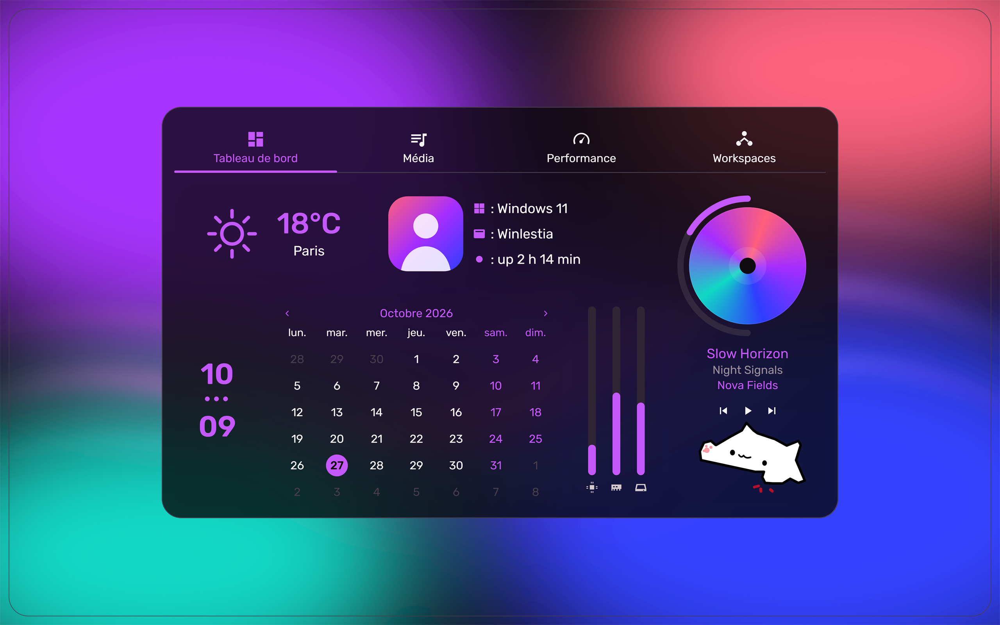
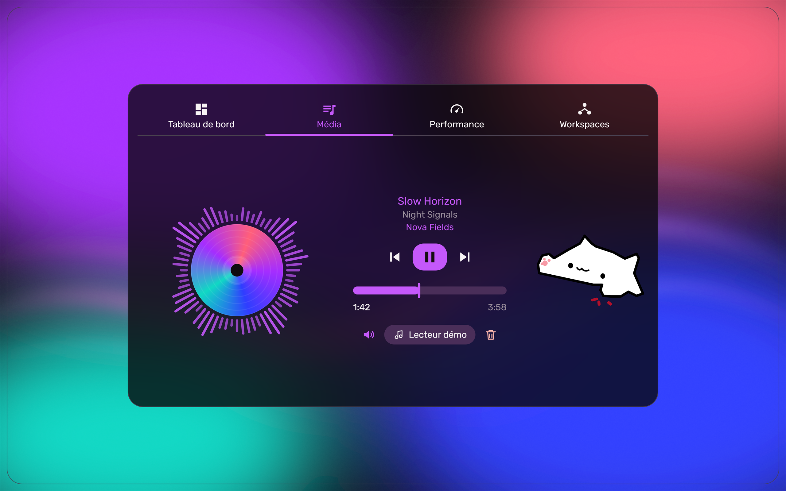
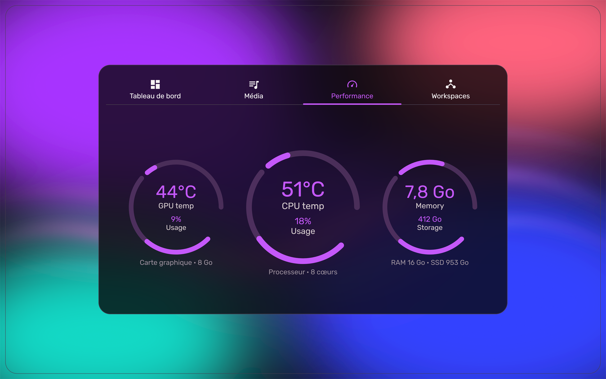
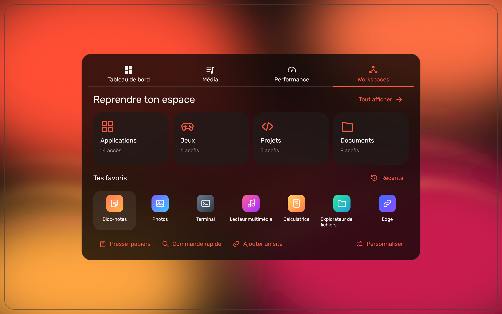
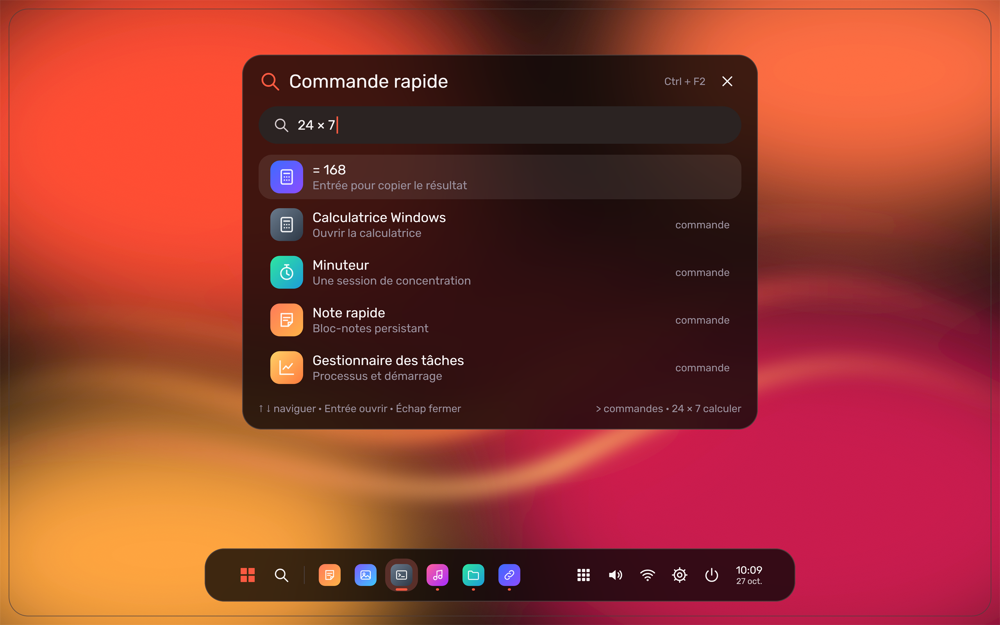
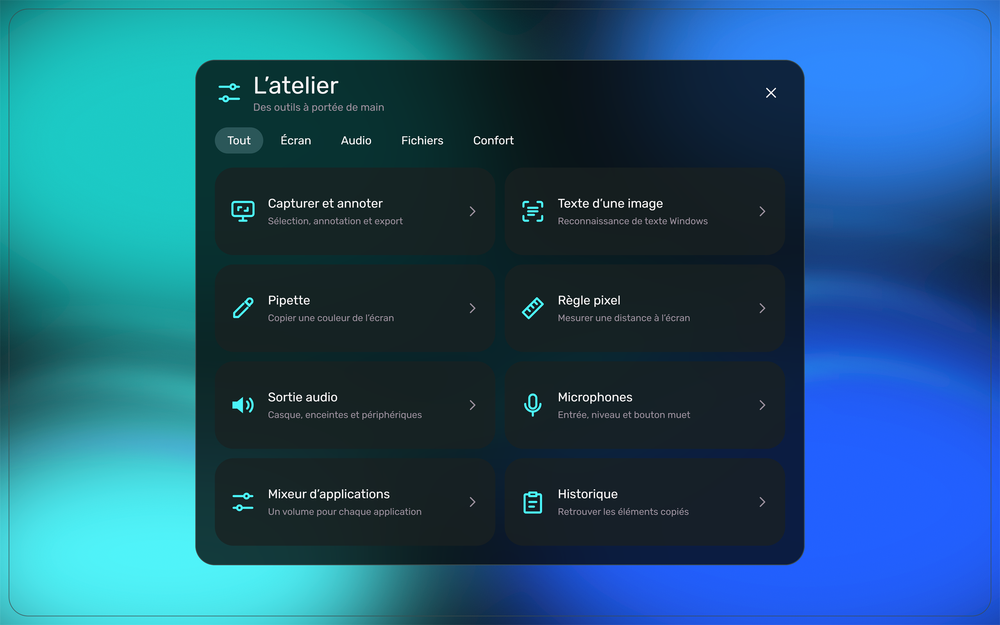
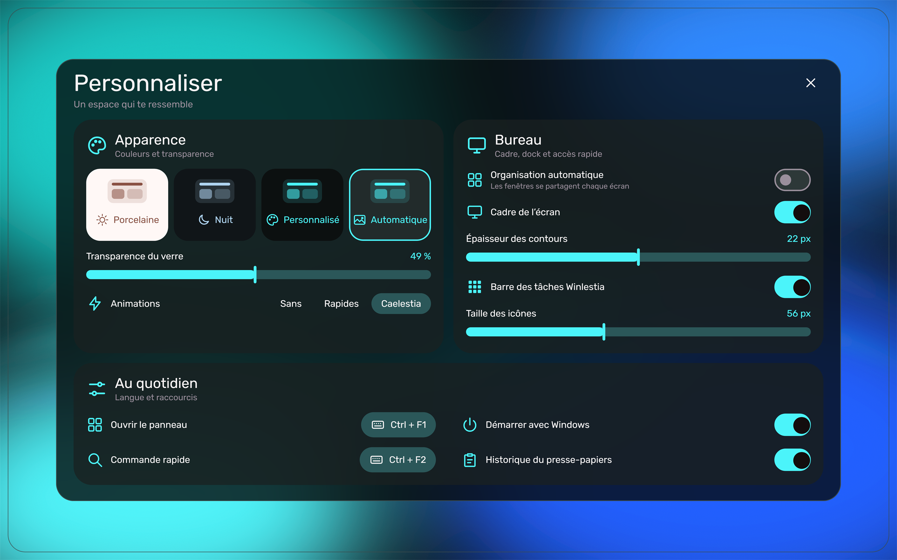
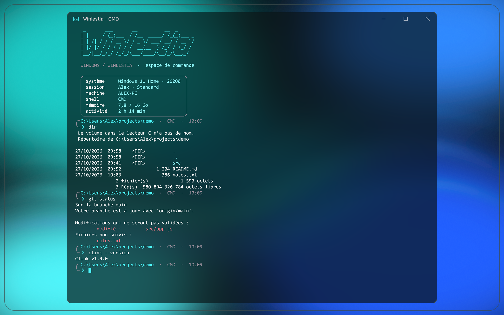

## What is Winlestia

Winlestia is a desktop shell for Windows 11. It replaces the surface of Windows, not the system: the taskbar is swapped for a dock, and a dashboard and glass panels sit on top of your normal desktop. Files, windows and wallpaper stay where they are.

The interface is a port of Caelestia; a .NET service handles the system side and Windows' own glass effect. The colors of the panels are derived from your wallpaper.

## Features

- Dashboard with media, performance and workspaces pages.
- Media page showing the track currently playing in Windows.
- Performance page with CPU, GPU, memory and network readings.
- Workspaces page listing installed applications, with search.
- Dock that replaces the Windows taskbar, with a quick command palette.
- Toolbox: screen capture, text recognition (OCR) on a captured area, color picker, clipboard history, focus timer and notes.
- Settings for theme, glass opacity, screen frame thickness, taskbar replacement, autostart and global shortcuts. Autostart is a per-user scheduled task named `WinlestiaShell` (logon trigger, `--qt-shell`, no admin); the old `Run` registry value is migrated to it at launch and kept as a fallback if the task cannot be created. Messaging apps are kept loaded in the background by default (option in Settings).
- Search field in the settings panel: finds a setting by title or description, ignoring case and accents, across all pages, then scrolls to it and highlights it.
- Quick controls panel: a "Reduced effects" switch; if Windows refuses a Wi-Fi or Bluetooth toggle, the matching Windows Settings page opens.
- Virtual desktop indicator in the dock: one dot per Windows desktop, the current one highlighted; click a dot or scroll to switch. It reads the desktop list from the registry and switches with the Win+Ctrl+arrow shortcut. It can be turned off in Settings. A "+" button next to the dots creates a new desktop (Win+Ctrl+D); right-click a dot to close that desktop (its windows move to the neighbouring one).
- Brightness of every display, external ones included (DDC/CI), in the quick controls panel; `winlestia brightness` lists them and `winlestia brightness <id> <0-100>` sets one.
- Wi-Fi in the quick controls panel: the arrow next to the Wi-Fi switch opens the network list (strength, lock, connected, remembered) with password entry, connect and forget. It uses Native Wifi (`wlanapi.dll`), scans only while the list is open (on opening, then every 15 s) and keeps no WLAN handle at rest. Winlestia never stores or shows passwords: the typed password is passed once to Windows, which remembers the network in your user WLAN profile (never a machine-wide profile, except if Windows itself rejects the per-user scope). The .NET strings that carried it cannot be wiped before garbage collection; only the character buffer and the native copy are cleared. A profile created for a failed attempt is deleted; an existing one is never deleted. Open, WPA2-Personal, WPA3-SAE (transition included) and WPA-Personal networks are handled; enterprise (802.1X) and hidden networks are not (button to Windows settings). `winlestia wifi` prints `{"available","connected","networks","reason"}` without any network name.
- Audio bars in the dashboard Media panel (WASAPI loopback of the default output, captured only while the panel is visible, nothing recorded); `winlestia visualizer` (the dashboard bars, i.e. the Media widget of the main tab) prints `{"running":b,"frames":n,"panelOpen":b,"wanted":b}` and `winlestia panel dashboard` toggles the dashboard.
- Fullscreen quiet mode (video, game, borderless window): the dock, OSD, audio bars, animations and edge tracking are switched off and the timers slow down, until the window leaves fullscreen; option in Settings, `winlestia quiet [on|off|auto]` to test.
- On-screen indicator (OSD) for volume, screen brightness and microphone mute, driven by system events. The native Windows volume popup is left as is.
- Accent border on applications (on by default), with an optional "Active window only" mode that colours only the foreground window.
- Automatic tiling (off by default): stable tile order, keyboard focus, swap, resize and float shortcuts (Ctrl+Alt+arrows, listed in Settings), drag-to-swap, and a per-application exclusion list. A dock button turns it on or off, same as the Settings toggle; it sits in a group next to the desktop dots that a small arrow shows or tucks away (state remembered).
- Command palette (Ctrl+F2): open windows, Windows Settings pages and, with `>file `, files from the Windows index (`winlestia find windows|files <term>` returns counts only). A shortcut added to the Start menu is listed a few seconds later, without restarting the shell.
- Command line `winlestia` (status, panel, desktop, wallpaper, palette, help) to drive the running shell from scripts, through a pipe reserved to the current user. Optional PATH entry at setup.
- Color palette generated from the wallpaper, with an automatic theme option.
- Wallpaper switcher (Ctrl+Alt+W): with several displays, Tab picks all displays or one; a line warns when DesktopHut, Wallpaper Engine, Lively or Wallpaper X is running. `winlestia wallpaper list` and `wallpaper <path> --display <id>` do the same from a script.
- Real blur and rounded corners provided by Windows itself.
- Enhanced Command Prompt powered by Clink (installed automatically), with colors synchronized to the same palette.
- Two shells in one install: the Caelestia (Qt Quick) shell and a legacy Glass (WPF) shell.

## Screenshots

| | |
|---|---|
|  Dashboard |  Media player |
|  Performance monitor |  Workspaces |
|  Dock and quick command |  Toolbox |
|  Settings |  Terminal with synchronized palette |

## Demo

Click the animation to open the full-quality video (1080p, 22 s).

A vertical version for mobile viewing is available at [docs/media/winlestia-tiktok.mp4](docs/media/winlestia-tiktok.mp4).

## Installation

Requirements:

- From the release setup: Windows 11 on a 64-bit (x64) PC, nothing else to install. The setup embeds the .NET 8 runtime (self-contained) and an embedded Python 3.12 with the Qt libraries. An Internet connection is needed during setup for Clink.
- From source: Windows 11 x64, the .NET 8 SDK (or the .NET 8 Desktop Runtime to run a build), Python 3.12 only for the Qt frontend, and Internet for Clink.
- The terminal component downloads Clink 1.9.35 from its official GitHub page (github.com/chrisant996/clink), checks the archive against a known SHA256 fingerprint before extracting it, then checks each extracted Clink binary against its own fingerprint.

1. Download `Winlestia-Setup-0.8.0.exe` from the [latest release](../../releases/latest). To check the download is intact, compare the output of `Get-FileHash .\Winlestia-Setup-0.8.0.exe` in PowerShell with the line for that file in `SHA256SUMS-0.7.6.txt`, published next to it.
2. Double-click the setup. It installs into `%LOCALAPPDATA%\Programs\Winlestia` (your own user folder), so it does not ask for administrator rights.
3. Answer the prompts: the display name, whether Winlestia starts with Windows, and whether to add a desktop shortcut.
4. Winlestia starts when the setup finishes, and the dock replaces the Windows taskbar.

If the terminal theme cannot be applied (for example, no Internet during setup), the setup shows a message and the rest of Winlestia still works. The details are in `Winlestia-Terminal\install-result.json` inside the install folder. Run the setup again once you are online.

The setup is not code-signed, so Windows SmartScreen may warn on first launch: choose "More info", then "Run anyway".

To update or uninstall, run the setup again: it detects the installed version and offers both options. Uninstalling restores the Windows taskbar. You can also uninstall from Settings, Apps. Your settings are kept.

## Usage

**Launch.** Start Winlestia from the Start menu or desktop shortcut, or run `Glass-v5\Panneaux.Glass.exe` (the main program) from the install folder (`%LOCALAPPDATA%\Programs\Winlestia`). Running it again while it is already open shows the shell instead of starting a second copy. `Panneaux.Glass.exe --quit` closes it.

**Which shell starts.** By default the Caelestia interface starts; to use the older Glass interface, delete `caelestia.enabled` in the `Glass-v5` folder. `--qt-shell` / `--legacy-shell` force one or the other.

**Global shortcuts** (defaults, reassignable in Settings):

| Shortcut | Action |
|---|---|
| Ctrl+F1 | Open the panel |
| Ctrl+F2 | Quick command: type `25/2`, `25:2` or `25 divisé par 2` to calculate (decimal comma in French and Spanish), `>emoji cat` (or `>emoji chat`) for a searchable emoji grid copied on Enter, `>wallpaper` to switch wallpaper |
| Ctrl+F3 | Screen capture |
| Ctrl+F8 | Pin a window on top |
| Win+Alt+W | Wallpaper switcher: Left/Right to preview, Enter to apply, Esc to close (falls back to Ctrl+Alt+W if Windows refuses it; configurable in Settings) |
| Ctrl+Alt+Backspace | Emergency desktop restore (see Troubleshooting) |

## Configuration

The data folders are named `Panneaux`, the project's former name.

| File | Purpose |
|---|---|
| `%LOCALAPPDATA%\Panneaux\preferences-glass.json` | Shell preferences. Change these options in Settings instead; the file is for advanced users. |
| `%LOCALAPPDATA%\Panneaux\Caelestia\weather.json` | Weather city, as `{"city": "..."}`. |
| `%LOCALAPPDATA%\Panneaux\glass.log` | Backend log. |

Advanced: the keys of `preferences-glass.json` include `ReplaceTaskbar`, `AutoTheme`, `ScreenFrame`, `FrameThickness`, `GlassOpacity`, `AutoTile`, `DesktopLogo`, `TaskbarPins` and the shortcuts `Shortcut`, `PaletteShortcut`, `CaptureShortcut`, `PinShortcut` (each with `Modifiers` and `Key`).

Command-line flags of `Panneaux.Glass.exe`:

| Flag | Effect |
|---|---|
| `--qt-shell` | Start the Caelestia (Qt Quick) shell. |
| `--legacy-shell` | Start the legacy Glass (WPF) shell, overriding `caelestia.enabled`. |
| `--restore-taskbar` | Restore the Windows taskbar and exit. |
| `--taskbar-guard <pid> <file>` | Internal use, do not run manually. |
| `--quit` | Close the running instance. |

## Troubleshooting

- **The Windows taskbar is missing.** Run `RETABLIR_BARRE_WINDOWS.exe` from the `Glass-v5` folder of the install, or run `Panneaux.Glass.exe --restore-taskbar`. A watchdog also restores the taskbar if Winlestia stops unexpectedly. You can disable the replacement with the taskbar option in Settings ("Barre des tâches Panneaux").
- **The desktop looks broken or icons are hidden.** Press Ctrl+Alt+Backspace. It runs `SECOURS_BUREAU.exe`, which brings back the Windows desktop icons, stops Winlestia and disables its autostart (the `WinlestiaShell` task is removed once `SECOURS_BUREAU.exe` is rebuilt from `Secours.cpp`). The executable can also be launched directly from the install folder.
- **The Caelestia shell does not start.** Start with `Panneaux.Glass.exe --legacy-shell` to use the Glass shell, and check `%LOCALAPPDATA%\Panneaux\glass.log`.
- **A shortcut does not work.** Another application may already own the combination. Pick a different one in Settings.
- **Windows protected your PC when launching the setup.** See the SmartScreen note under Installation.

## License

Winlestia is released under the GNU General Public License v3.0. See [LICENSE](LICENSE). Third-party components and their licenses are listed in [THIRD_PARTY_NOTICES.md](THIRD_PARTY_NOTICES.md).
