

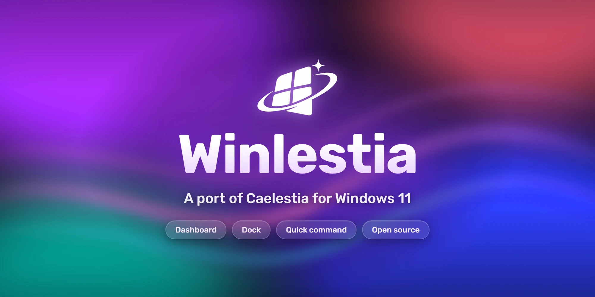

# Winlestia

**A free, open-source desktop shell for Windows 11.**

[Download](https://github.com/lilidoxdev/winlestia/releases/tag/v0.9.0) · [Demo](#demo) · [Install guide](docs/INSTALL.md) · [Shortcuts](docs/SHORTCUTS.md) · [Troubleshooting](docs/TROUBLESHOOTING.md) · [Discord](https://discord.gg/5jXv7NRj3Q)

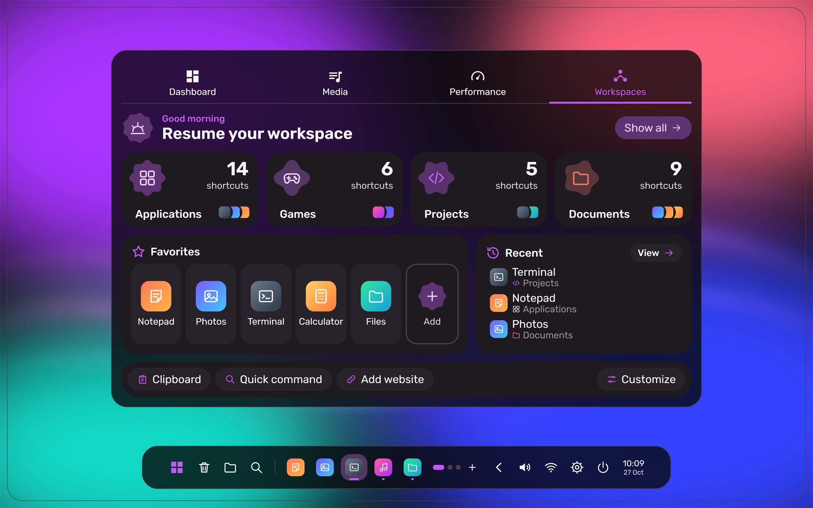

## Demo

<a href="docs/media/winlestia-showcase-16x9.mp4">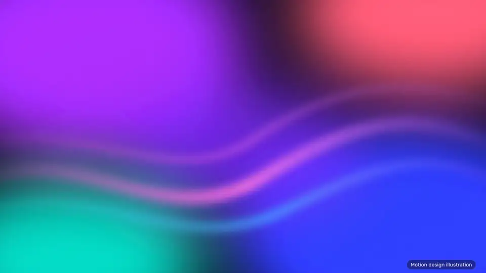</a>

[Watch the 16:9 video](docs/media/winlestia-showcase-16x9.mp4) · [Vertical 9:16 version](docs/media/winlestia-vertical-9x16.mp4)

These visuals are motion-design illustrations made in HTML/CSS. They are not screen captures.

## What is Winlestia

Winlestia is a free, open-source desktop shell for Windows 11, bringing a Caelestia-inspired interface, dynamic themes, glass effects, a customizable dock and powerful desktop tools.

It replaces the surface of Windows, not the system. The taskbar is swapped for a dock, and a dashboard and glass panels sit on top of your normal desktop. Your files, windows and wallpaper stay where they are. The interface is a port of [Caelestia](https://github.com/caelestia-dots/shell) (Qt Quick), and a .NET 8 service handles the Windows side. Panel colours can be derived from your wallpaper (see [Wallpaper and dynamic theme](#wallpaper-and-dynamic-theme)).

## Features

The images in this section are motion-design illustrations made in HTML/CSS, not screen captures (see [docs/illustrations](docs/illustrations/README.md)).

### Dashboard
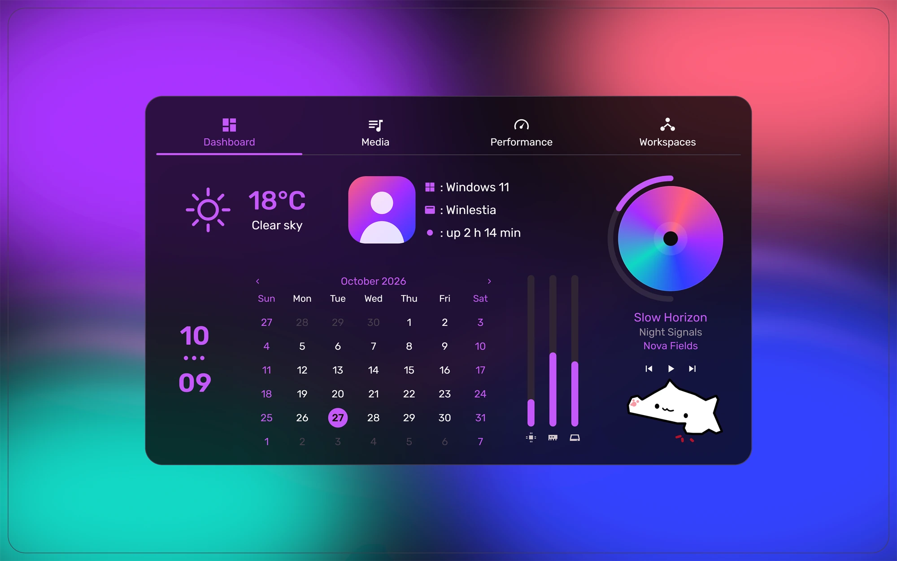

Press **Ctrl+F1**. The dashboard has four pages: **Dashboard** (clock, calendar, weather, media), **Media**, **Performance** and **Workspaces**.

- Media: the track playing in Windows, with audio bars that run only while the panel is visible. Nothing is recorded.
- Performance: CPU, GPU, memory and storage readings.
- Workspaces: your applications, games, projects and documents, with search.

### Workspaces
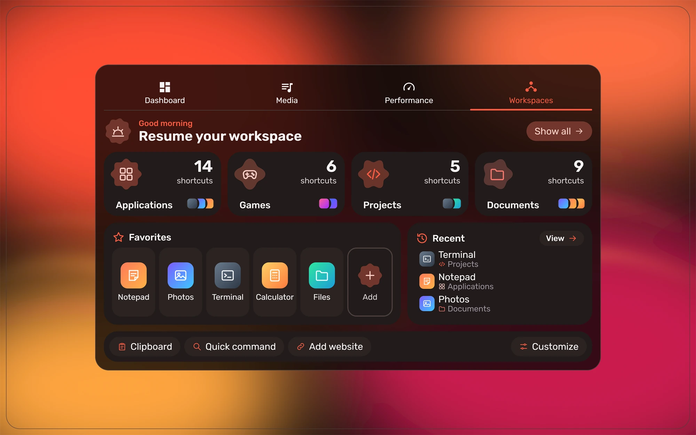

Applications, Games, Projects and Documents boards, your favorites, recent shortcuts and quick actions (Clipboard, Quick command, Add website, Customize).

### Dock and command palette
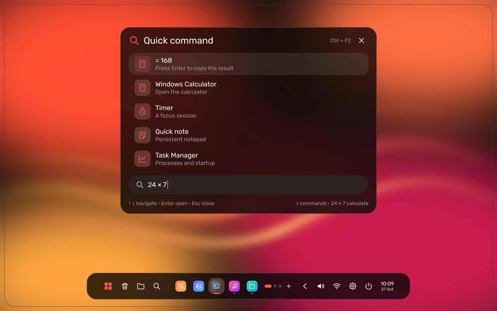

- A dock instead of the Windows taskbar, with window previews on hover and a virtual-desktop indicator. The dock auto-hides: it slides away a fraction of a second (about 0.45 s) after the pointer leaves it, and appears when the pointer reaches the bottom edge of the screen. The Windows key opens the normal Windows Start menu.
- **Ctrl+F2** opens the palette: calculator, `>emoji`, `>wallpaper`, `>file ` for indexed files, open windows, Windows Settings pages and session actions (each asks for confirmation).

### Media and quick controls
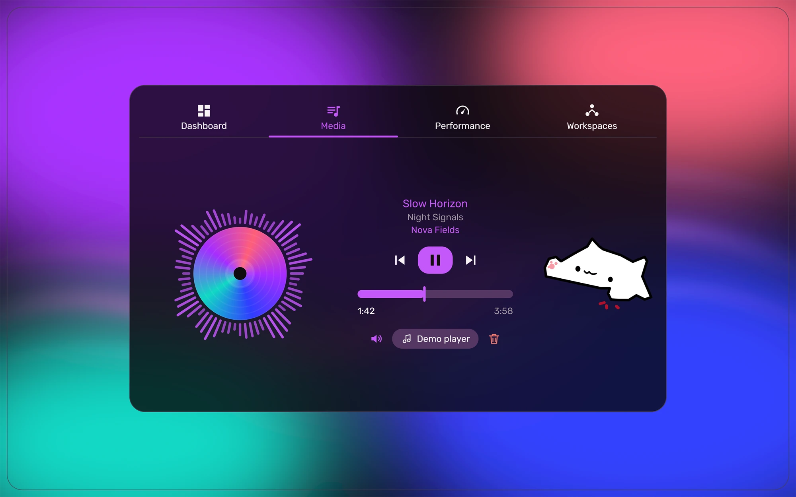

Quick controls include a Wi-Fi network list, per-display brightness (DDC/CI, external displays too) and a "Reduced effects" switch. Audio and per-application mixer panels are included.

### Performance

### Tools
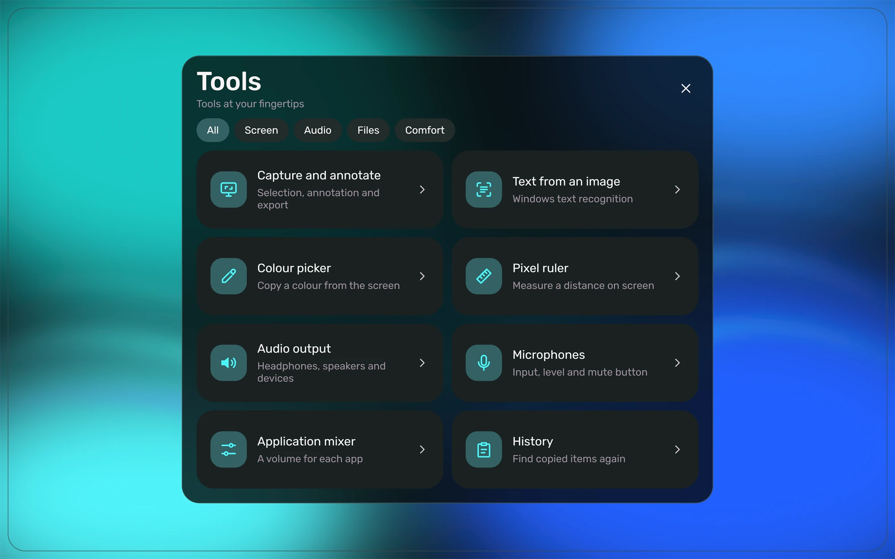

Screen capture with annotation (**Ctrl+F3**), text recognition (OCR) on a captured area, colour picker, pixel ruler, clipboard history, focus timer, notes, pin a window on top (**Ctrl+F8**), a large-files view, and a recycle-bin / clipboard / zip drop zone that appears when you drag a file toward the top of the screen.

### Wallpaper and dynamic theme
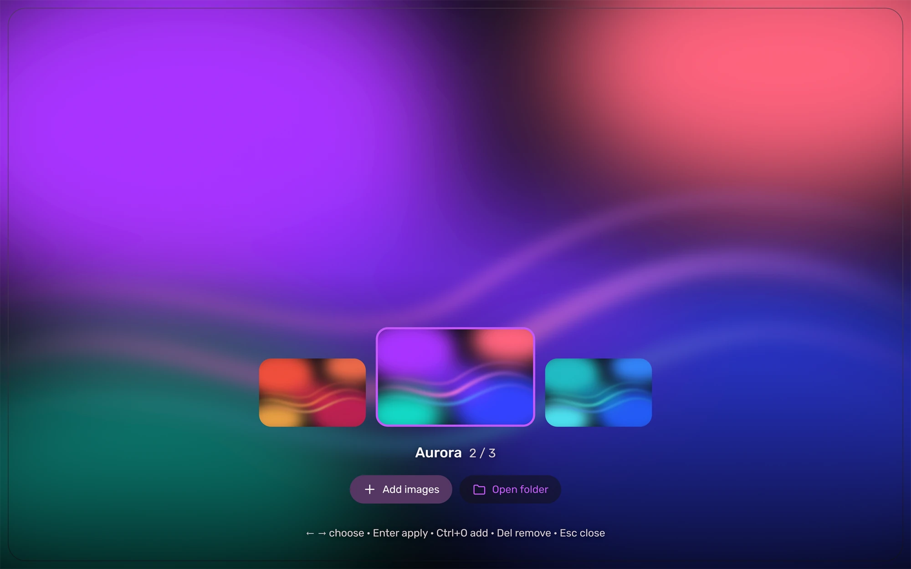

**Win+Alt+W** opens a full-screen wallpaper switcher with live preview and per-display targeting. A fresh install uses the **Porcelain** theme (light, warm), which is fixed and does **not** follow the wallpaper; the **Automatic** theme does. To get colours from the wallpaper, open Settings (Customize), then Appearance, then Theme, and select **Automatic**. Glass blur comes from Windows itself. The Automatic theme starts with a glass transparency of 5 %, adjustable in Settings.

### Settings
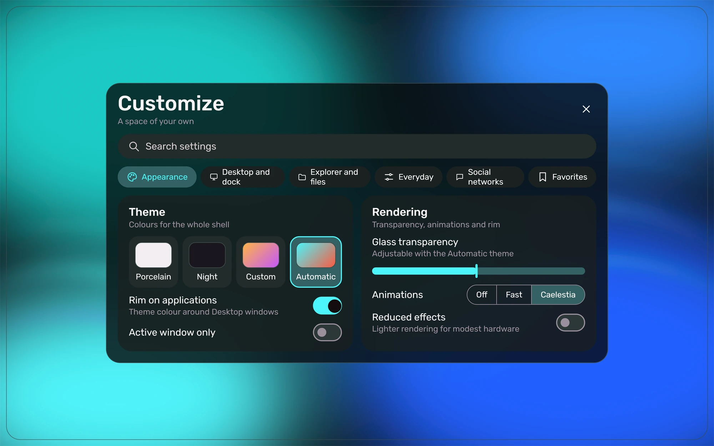

Six pages with a search field: appearance, desktop and dock, file explorer, daily use, messengers and bookmarks. Screen frame, accent border on windows, desktop logo, quiet mode (dock and OSD hidden during fullscreen), on-screen indicators for volume, brightness and microphone, and optional automatic tiling (off by default; Ctrl+Alt+arrows).

### Terminal
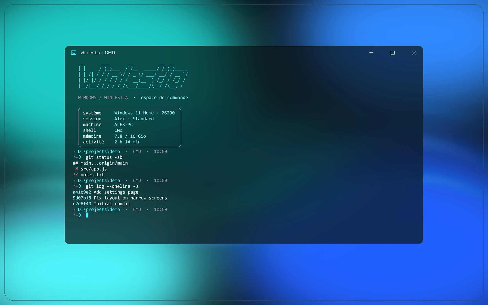

Opt-in at setup: Command Prompt through [Clink](https://github.com/chrisant996/clink), with colours synchronized to the wallpaper palette. Reversible. Clink is downloaded at install time, so this option needs an Internet connection.

### Panels
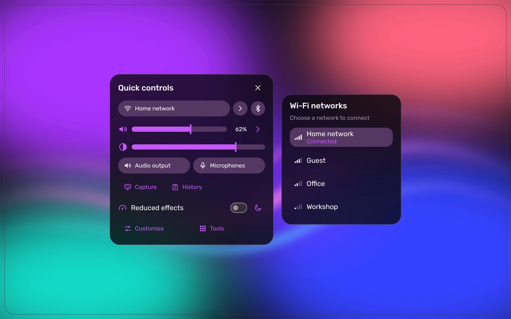

Also: a Files explorer, messenger and bookmark side rails, an optional push-to-talk dictation (hold AltGr, off by default), and a `winlestia` command line to script the running shell.

## Install

Requires **Windows 11 (64-bit)**. No administrator rights needed.

1. Download [`Winlestia-Setup-0.9.0.exe`](https://github.com/lilidoxdev/winlestia/releases/download/v0.9.0/Winlestia-Setup-0.9.0.exe) from the [release](https://github.com/lilidoxdev/winlestia/releases/tag/v0.9.0).
2. Check it: run `Get-FileHash .\Winlestia-Setup-0.9.0.exe -Algorithm SHA256` in PowerShell and compare the result with the SHA-256 printed in the [release notes](https://github.com/lilidoxdev/winlestia/releases/tag/v0.9.0).
3. Run it. The binaries are **not code-signed**, so SmartScreen will likely warn: choose **More info**, then **Run anyway**.

After installing, move the pointer to the bottom edge of the screen to reveal the dock. The setup wizard is in French only. Full guide, options, updating and uninstalling: [docs/INSTALL.md](docs/INSTALL.md).

## Usage

| Shortcut | Action |
|---|---|
| Ctrl+F1 | Dashboard |
| Ctrl+F2 | Command palette |
| Ctrl+F3 | Screen capture |
| Ctrl+F8 | Pin window on top |
| Win+Alt+W | Wallpaper switcher (Ctrl+Alt+W if Windows refuses it) |
| Ctrl+Alt+Backspace | Emergency rescue |

All shortcuts (reassignable in Settings), palette prefixes and the `winlestia` command: [docs/SHORTCUTS.md](docs/SHORTCUTS.md).

## FAQ

**The Windows taskbar is missing.** Wait a few seconds (a watchdog restores it), press Ctrl+Alt+Backspace, use the Start menu shortcut "Restaurer la barre des tâches Windows", or run `Panneaux.Glass.exe --restore-taskbar` or `RETABLIR_BARRE_WINDOWS.exe` in the `Glass-v5` folder of the install. See [docs/TROUBLESHOOTING.md](docs/TROUBLESHOOTING.md).

**Why does Windows warn me about the installer?** The installer and the programs it installs are not code-signed, so SmartScreen cannot show a publisher. Verify the SHA-256, then use "More info", "Run anyway". A matching checksum shows the file is the published one; it does not replace a signature.

**Is there a notification centre?** No. Only on-screen indicators and toasts.

**Where are my settings and logs?** In `%LOCALAPPDATA%\Panneaux`. The name is the project's former name, kept on purpose. Uninstalling keeps this folder; see Privacy and data below to remove it.

**Why "Panneaux" in some file names?** Same reason: legacy name.

## Known limitations

- The installer wizard is in French only.
- The shell panels are translated into English and Spanish; some rarer labels derived from the system may still appear in French. The language is chosen automatically from the Windows display language. To force it, set the `language` key (`auto`, `fr`, `en` or `es`) in `%LOCALAPPDATA%\Panneaux\Caelestia\language.json`. Fallback text is French.
- Not tested on a clean machine or virtual machine, and not tested after a real reboot or sign-in (the start-up scheduled task was launched manually).
- Binaries are unsigned, so SmartScreen may warn.
- Windows 11 x64 only.
- Temperature is shown in Celsius only.
- Not a notification centre.
- The optional terminal integration prints a welcome banner in French, with your session and computer names.
- When you confirm a wallpaper in the switcher, the previous one can flash briefly before the new one appears.

## Privacy and data

- Weather: when no city is set, your approximate location is found from your IP address through wttr.in (which therefore sees your IP address); the forecast comes from Open-Meteo. Set a city to avoid the IP lookup. Temperature is in °C only.
- Start-up: the installer writes a Run value named `Panneaux` under `HKCU`. On the first shell start it is migrated to a per-user scheduled task, `WinlestiaShell`, and the Run value is removed.
- After uninstalling, the registry value `HKCU\Software\Winlestia\DisplayName` and the profile folder `%LOCALAPPDATA%\Panneaux` are kept so a later update can reuse them. To remove them, delete the folder and run `Remove-Item -Path HKCU:\Software\Winlestia -Recurse` in PowerShell.

## Roadmap

**Shipped in 0.9.0:** Wi-Fi panel, per-display brightness, dashboard audio bars, fullscreen quiet mode, full-screen wallpaper switcher, richer command palette, settings search, tiling shortcuts, `winlestia` command line. See [CHANGELOG.md](CHANGELOG.md).

**Ideas, not promises:** a notification centre, support for enterprise and hidden Wi-Fi networks, more testing on other display layouts, and a code-signed installer.

## Contributing

Issues and pull requests are welcome; see [CONTRIBUTING.md](CONTRIBUTING.md). Report security problems privately: [SECURITY.md](SECURITY.md).

## Licence and credits

Winlestia is released under the [GNU GPL v3.0](LICENSE). It is a port of and is inspired by [Caelestia](https://github.com/caelestia-dots/shell) by caelestia-dots and contributors (GPL-3.0). The optional terminal integration uses [Clink](https://github.com/chrisant996/clink) (GPL-3.0), fetched at install time. Qt/PySide6, .NET, NAudio, LibreHardwareMonitor and other components, are listed in [THIRD_PARTY_NOTICES.md](THIRD_PARTY_NOTICES.md).

**Bundled wallpapers.** The 10 images in `assets/wallpapers` were supplied by the maintainer and are shipped as unmodified original files. They are **not** covered by the GPL-3.0 licence: rights remain with their owners and their licence has not been established. See [assets/wallpapers/CREDITS.txt](assets/wallpapers/CREDITS.txt). A rights holder can ask for an image to be removed by opening a [GitHub issue](https://github.com/lilidoxdev/winlestia/issues).
