

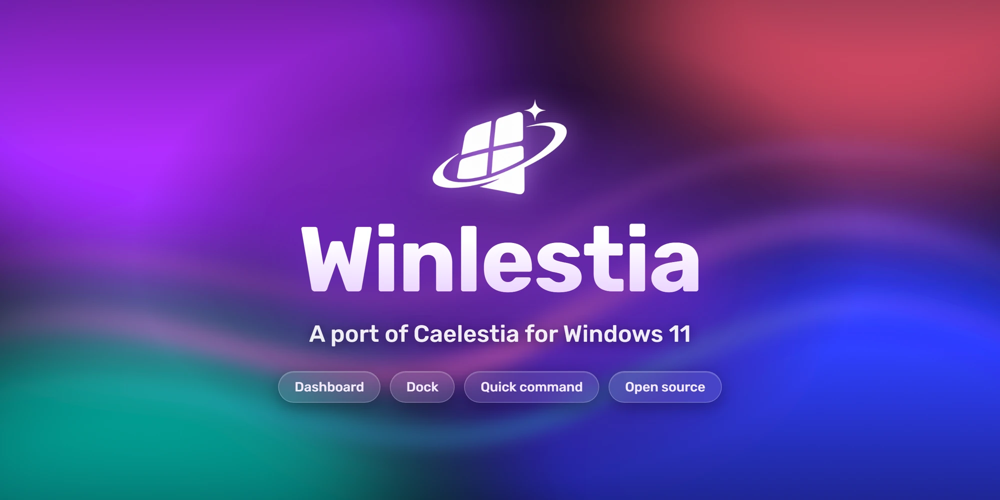

# Winlestia

**A free, open-source desktop shell for Windows 11, with colours derived from your wallpaper.**

[Download WinlestiaSetup.exe](https://github.com/lilidoxdev/winlestia/releases/latest) · [Release 1.0.1](https://github.com/lilidoxdev/winlestia/releases/tag/v1.0.1) · [Install guide](docs/INSTALL.md) · [Shortcuts](docs/SHORTCUTS.md) · [Troubleshooting](docs/TROUBLESHOOTING.md) · [Discord](https://discord.gg/5jXv7NRj3Q)

Winlestia replaces the surface of Windows 11 (taskbar, panels, launcher), not the system. The taskbar is swapped for a dock, and a dashboard,
glass panels and desktop widgets (Winjets) sit on top of your normal desktop. Your files, windows and wallpaper stay where they are.

It is a port of [Caelestia](https://github.com/caelestia-dots/shell), its visual reference. The interface uses Qt Quick, and a .NET 8 service
handles the Windows side. Version 1.0 is the first stable release.

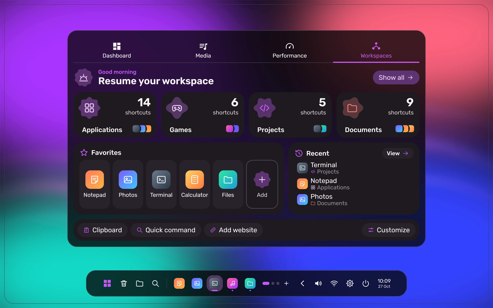

## Colour follows your wallpaper

With the **Automatic** theme, the colours of the panels are derived from the current wallpaper. Change the wallpaper and the shell is recoloured.
A fresh install uses the **Porcelain** theme (light, warm), which is fixed and does not follow the wallpaper. To switch, open Settings
(Customize), then Appearance, then Theme, and select **Automatic**. The Automatic theme starts with a glass transparency of 5 %, adjustable in
Settings. Glass blur comes from Windows itself.

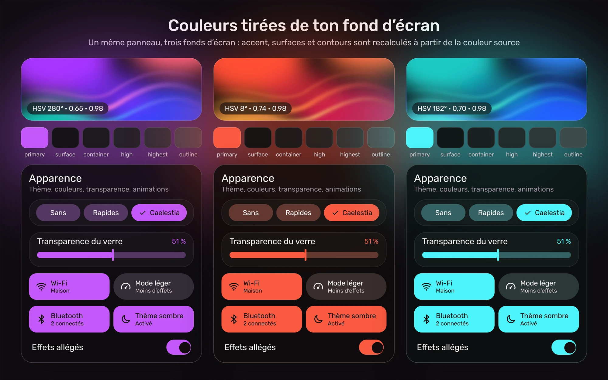

The optional terminal integration applies the same palette to Command Prompt (see the Terminal entry in [More](#more)).

## Demo

<a href="docs/media/winlestia-showcase-16x9.mp4">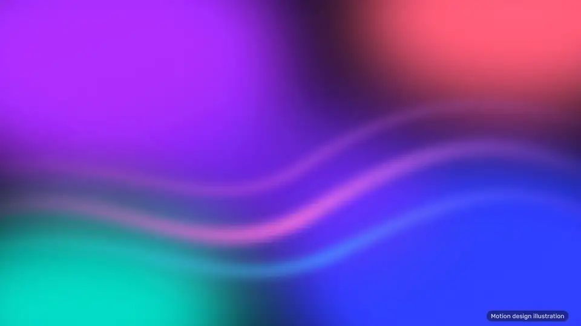</a>

[Watch the 16:9 video](docs/media/winlestia-showcase-16x9.mp4) · [Vertical 9:16 version](docs/media/winlestia-vertical-9x16.mp4)

The images and videos in this page are motion-design illustrations made in HTML/CSS. They are not screen captures
(see [docs/illustrations](docs/illustrations/README.md)).

## What is new in 1.0

- **Dock**: it grows with the open apps and scrolls when it overflows; optional battery pill for Bluetooth and XInput devices; pins of Store (MSIX)
  apps survive app updates and reboots; windows no longer slip between the dock's glass background and its icons.
- **Control center**: Wi-Fi page, Bluetooth device connect/disconnect, audio output and microphone pages, per-application mixer.
- **Command palette**: faster to open, including the first time after start-up.
- **Winjets**: ten built-in desktop widgets that replace the PC Widgets pack, drawn with the liquid glass v2 treatment and fed with real data.
- **Social rail**: the right-edge panel gathers notifications from Discord, Instagram, Snapchat, WhatsApp and Telegram.
- **Also**: push-to-talk voice dictation (off by default), redesigned file manager, lock screen, window overview, and a new WPF installer and uninstaller.

Full list: [CHANGELOG.md](CHANGELOG.md) and [release notes](docs/RELEASE-NOTES-1.0.md).

## Feature tour

### Dock

A dock instead of the Windows taskbar, with window previews on hover and a virtual-desktop indicator. It grows with the open apps and scrolls
with the mouse wheel when it overflows. It auto-hides: it slides away about 0.45 s after the pointer leaves it, and appears when the pointer
reaches the bottom edge of the screen. The Windows key opens the normal Windows Start menu.

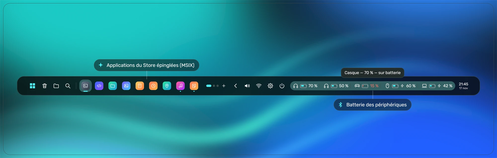

Optional battery indicator for connected Bluetooth and XInput devices (headset, gamepad, mouse, keyboard), next to the clock: one icon, gauge
and percentage per device, in the error colour at 20 % or less. Hovering shows the name and state, clicking opens the Controls panel. Off by
default; enable it and choose which paired devices appear, and their type, in Settings > Docks and panels > Icon bar.

### Control center and social rail

The Control center has toggle tiles (Wi-Fi, Bluetooth, Dark theme, Light mode), volume and per-display brightness sliders (DDC/CI, external
displays too) and capture/clipboard shortcuts. Wi-Fi, Bluetooth and Sound sub-pages open inside the panel: Wi-Fi network list, Bluetooth device
connect/disconnect, output/input device selection and per-application volume. The right-edge social rail gathers notifications from Discord,
Instagram, Snapchat, WhatsApp and Telegram.

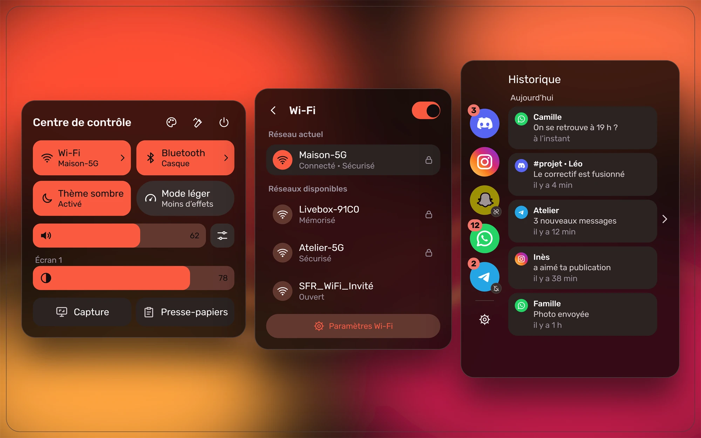

### Winjets

Small desktop widgets placed behind your windows, drawn with the liquid glass v2 treatment. The ten built-in Winjets are Calendar, Clock, Music,
System, Markets, Storage, Files, Notes, Agenda and Weather, plus Battery. Editing and custom Winjets:
see [Winjets: editing and custom packages](#winjets-editing-and-custom-packages).

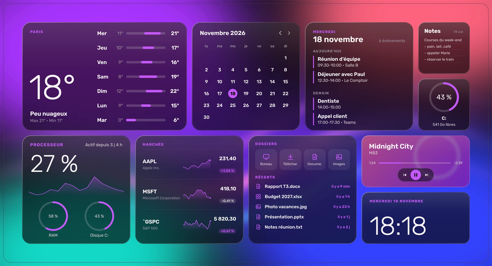

### Personalization and settings

Settings has a search field: a result opens its page and highlights the row. The Appearance page holds the theme, the wallpaper palette,
glass transparency and animation speed. Pages: Appearance, Interface, Docks and panels, Keyboard shortcuts, Media and audio, Apps, bookmarks
and links, Files and Windows, General, Winjets, Lock.

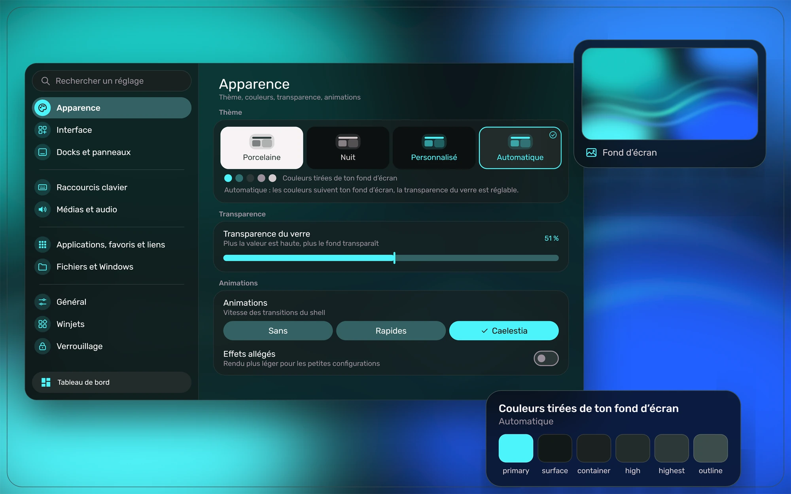

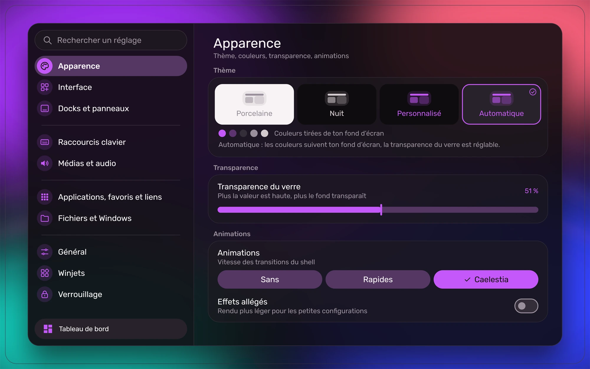

- **Docks and panels**: the dock, the bookmarks panel (left edge) and the social networks panel (right edge) can each be hidden. Hiding the dock
  while it replaces the Windows taskbar gives the Windows taskbar back, so there is always one bar.
- **Keyboard shortcuts**: every global shortcut in one page, grouped. "Modifier" opens a capture dialog; a combination reserved by Windows or
  already used by another action is refused with the reason. Fixed shortcuts (backup dashboard shortcut, desktop rescue, tiling keys, dictation
  key) show why they cannot be changed here. A shortcut that another application already holds at start-up is flagged "Inactif".
- **Opening Settings**: **Win+Alt+S** (reassignable), the tray icon menu ("Paramètres de Winlestia"), or `winlestia panel settings` from a terminal.
- Also in Settings: screen frame, accent border on windows, desktop logo, quiet mode (dock and OSD hidden during fullscreen), on-screen
  indicators for volume, brightness and microphone, and optional automatic tiling (off by default; Ctrl+Alt+arrows).

### Lock screen

Press **Ctrl+Alt+L**.

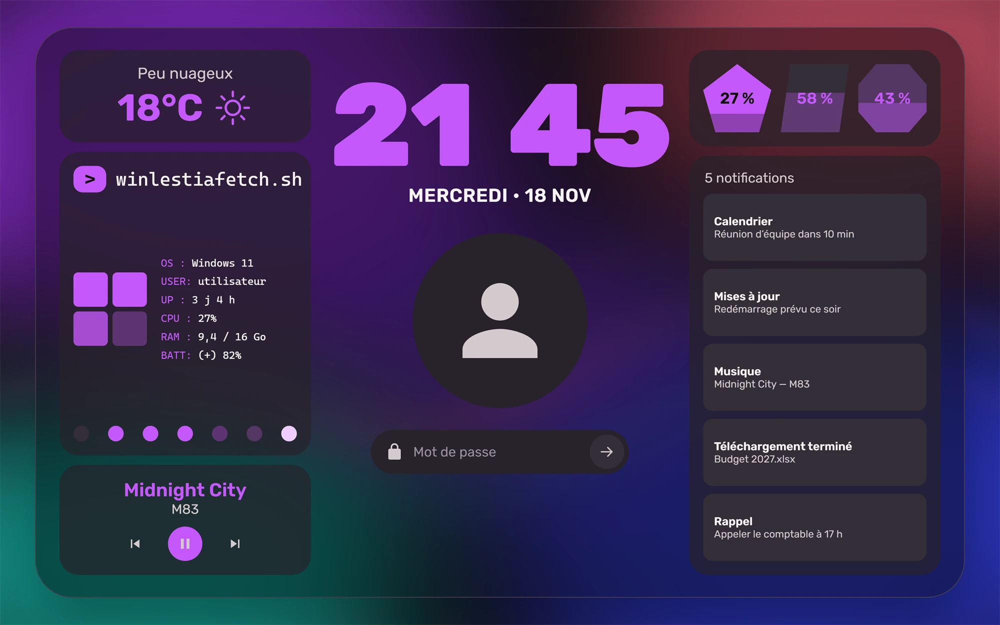

### Window overview

Press **Win+Alt+Tab** (Win+Alt+V if Windows refuses it).

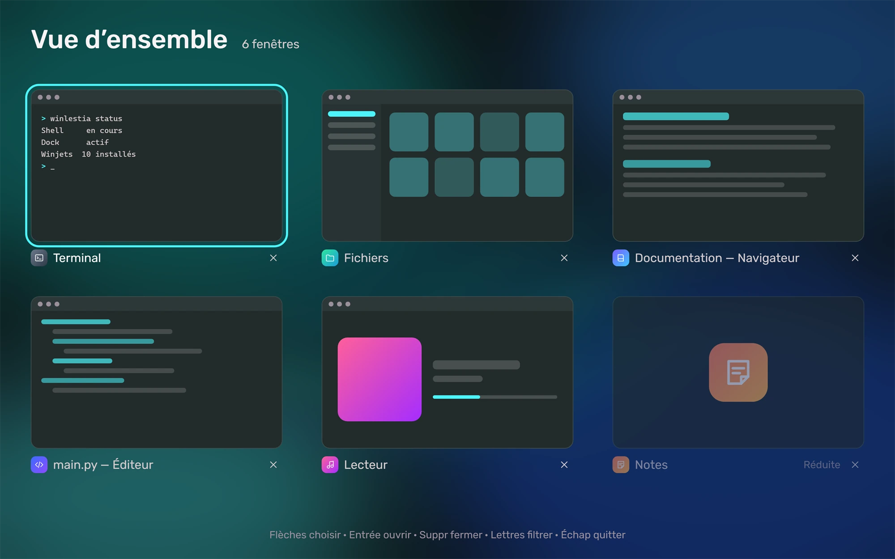

### Push-to-talk dictation

Hold **AltGr** to dictate. Off by default.

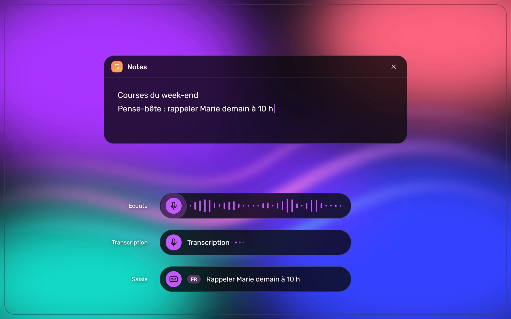

### Winlestia Fichiers

The redesigned file manager.

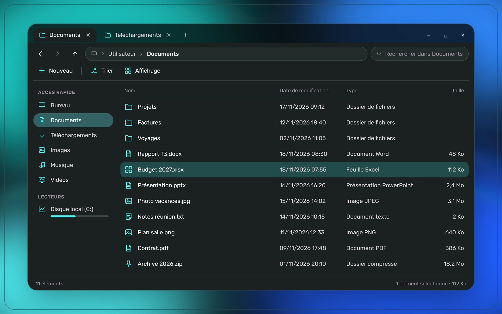

### Dashboard

Press **Ctrl+F1**. The dashboard has four pages: **Dashboard** (clock, calendar, weather, media), **Media**, **Performance** and **Workspaces**.

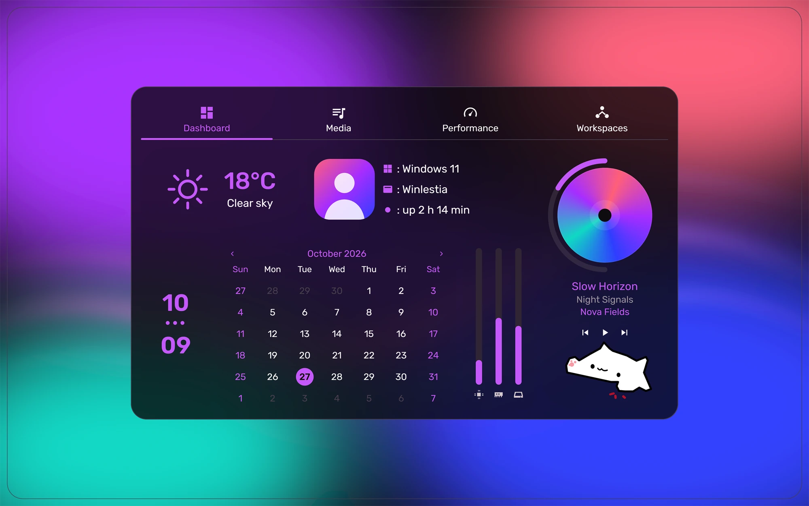

- Media: the track playing in Windows, with audio bars that run only while the panel is visible. Nothing is recorded.
- Performance: CPU, GPU, memory and storage readings.
- Workspaces: your applications, games, projects and documents, with search.

### More

<table>
<tr>
<td width="50%" valign="top">

**Workspaces**

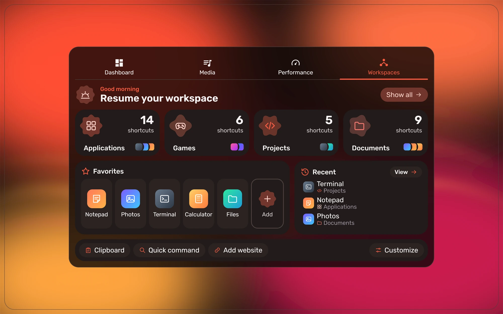

Applications, Games, Projects and Documents boards, your favorites, recent shortcuts and quick actions (Clipboard, Quick command, Add website,
Customize).

</td>
<td width="50%" valign="top">

**Media**

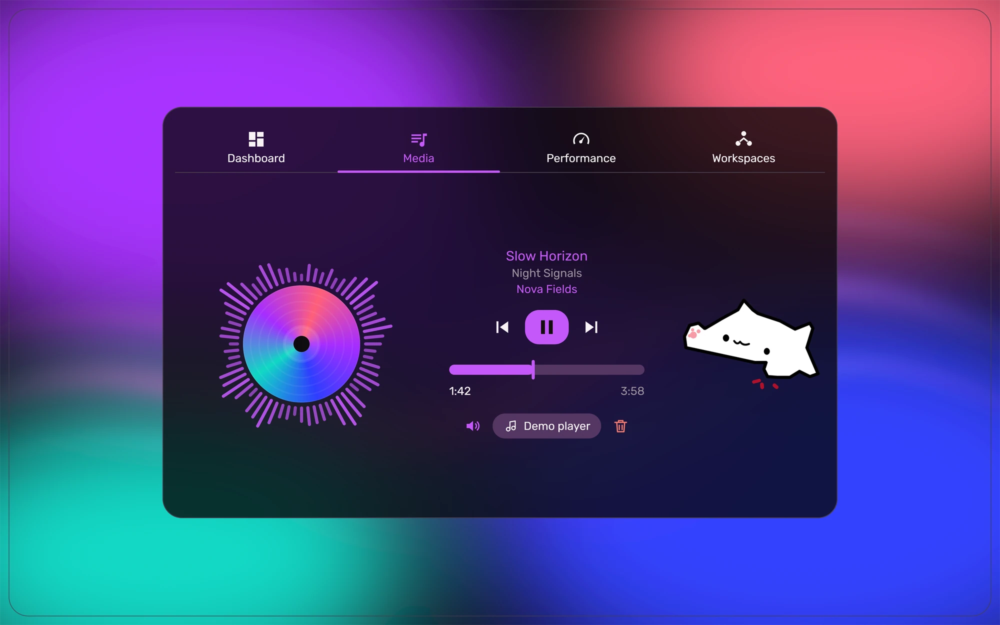

The track playing in Windows, in the dashboard and in the Control center.

</td>
</tr>
<tr>
<td width="50%" valign="top">

**Performance**

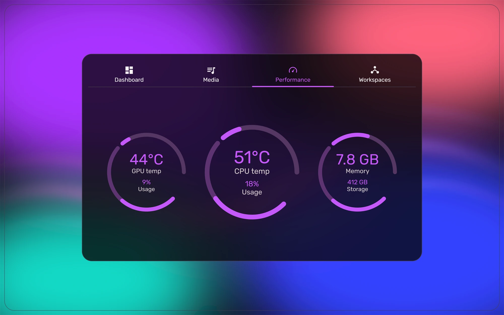

CPU, GPU, memory and storage readings.

</td>
<td width="50%" valign="top">

**Tools**

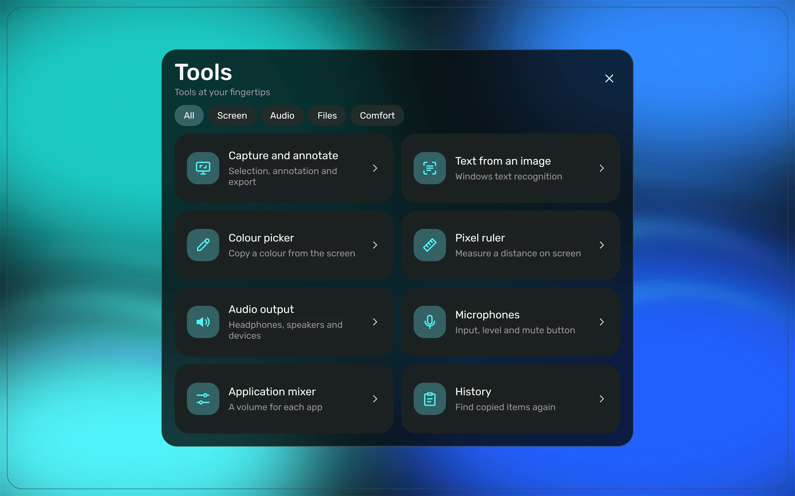

Screen capture with annotation (**Ctrl+F3**), text recognition (OCR) on a captured area, colour picker, pixel ruler, clipboard history, focus
timer, notes, pin a window on top (**Ctrl+F8**), a large-files view, and a recycle-bin / clipboard / zip drop zone that appears when you drag a
file toward the top of the screen.

</td>
</tr>
<tr>
<td width="50%" valign="top">

**Wallpaper switcher**

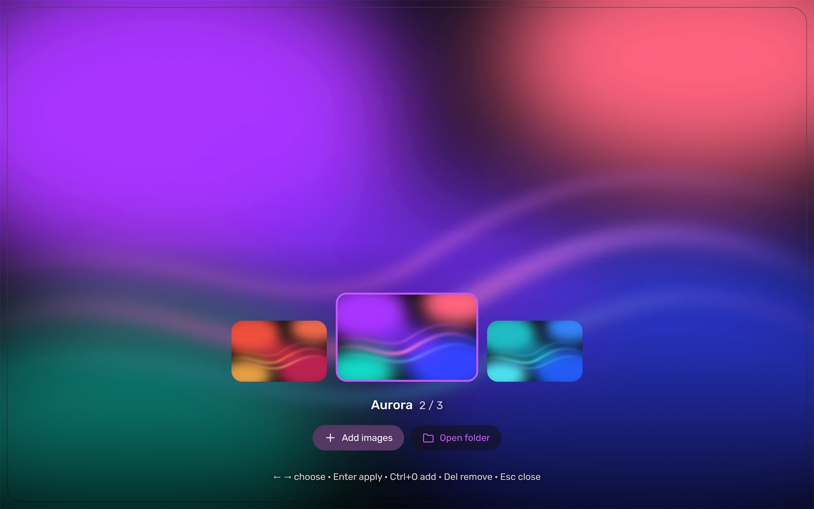

**Win+Alt+W** opens a full-screen wallpaper switcher with live preview and per-display targeting.

</td>
<td width="50%" valign="top">

**Terminal**

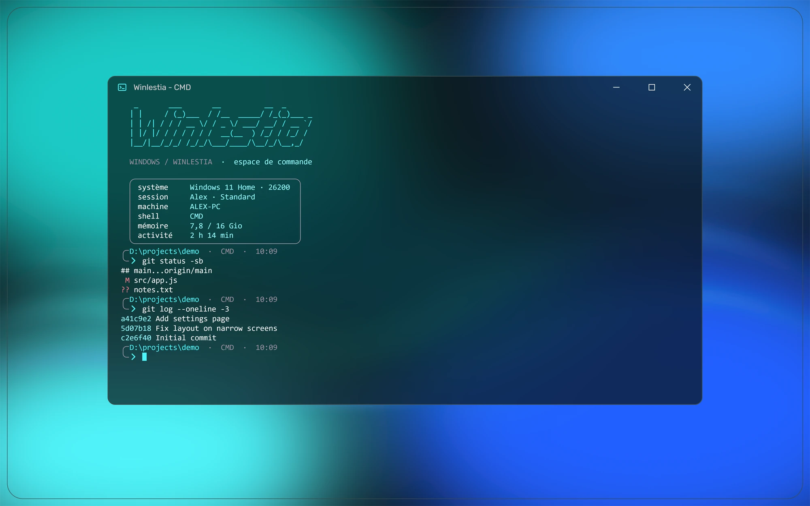

Opt-in at setup: Command Prompt through [Clink](https://github.com/chrisant996/clink), with colours synchronized to the wallpaper palette.
Reversible. Clink is downloaded at install time, so this option needs an Internet connection.

</td>
</tr>
<tr>
<td width="50%" valign="top">

**Dock and command palette**

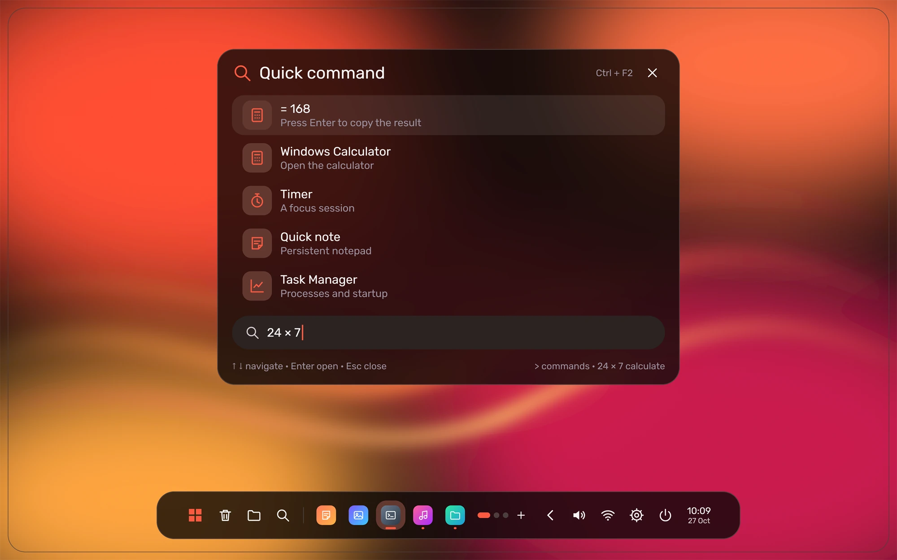

**Ctrl+F2** opens the palette: calculator, `>emoji`, `>wallpaper`, `>file ` for indexed files, open windows, Windows Settings pages and session
actions (each asks for confirmation).

</td>
<td width="50%" valign="top">

**Panels**

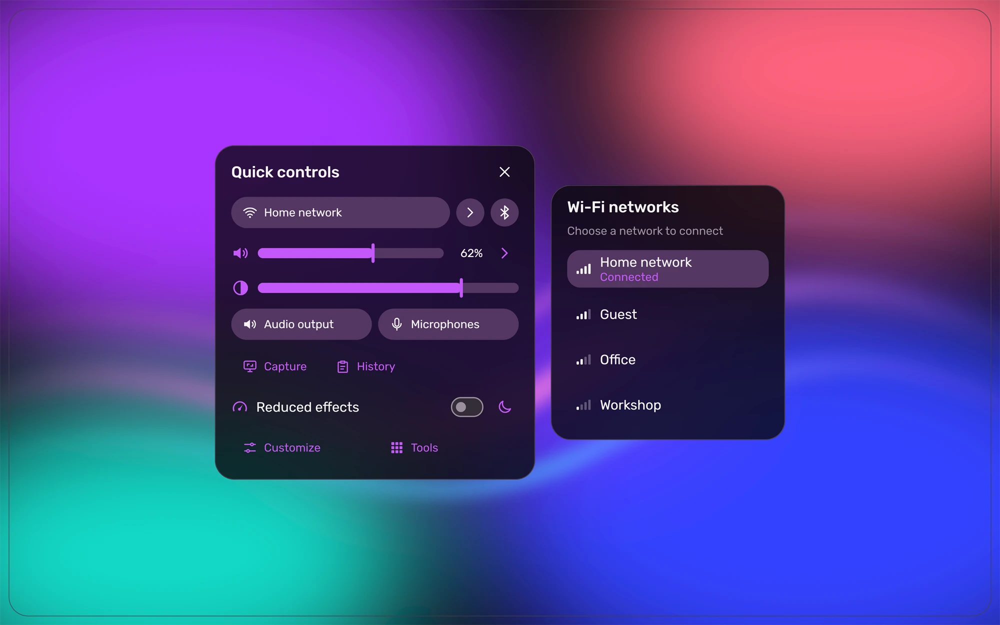

Messenger and bookmark side rails, and a `winlestia` command line to script the running shell.

</td>
</tr>
</table>

## Install

Requires **Windows 11 (64-bit)**. No administrator rights needed.

1. Download `WinlestiaSetup.exe` from the [GitHub Releases page](https://github.com/lilidoxdev/winlestia/releases/latest).
2. Check it: run `Get-FileHash .\WinlestiaSetup.exe -Algorithm SHA256` in PowerShell and compare the result with the SHA-256 printed in the release notes.
3. Run it. The binaries are **not code-signed**, so SmartScreen will likely warn: choose **More info**, then **Run anyway**.

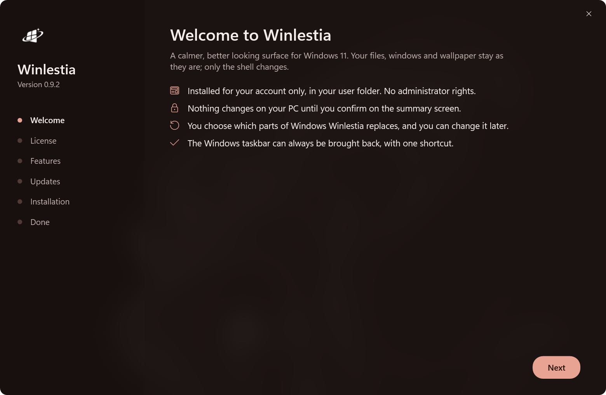

After installing, move the pointer to the bottom edge of the screen to reveal the dock. Full guide, options and updating: [docs/INSTALL.md](docs/INSTALL.md).

### Uninstall

Run `WinlestiaSetup.exe` again and choose uninstall, or use Settings > Apps > Installed apps > Winlestia, or the "Désinstaller Winlestia" entry of the power menu. The Windows taskbar is restored first. You choose whether settings and data (`%LOCALAPPDATA%\Panneaux`) are kept or sent to the Recycle Bin.

### Restore the Windows taskbar

If the taskbar is missing: press **Ctrl+Alt+Backspace**, or run `Panneaux.Glass.exe --restore-taskbar` from the `Glass-v5` folder of the install. More options: [docs/RESTORE.md](docs/RESTORE.md).

## Usage

| Shortcut | Action |
|---|---|
| Ctrl+F1 | Dashboard |
| Ctrl+F2 | Command palette |
| Ctrl+F3 | Screen capture |
| Ctrl+F8 | Pin window on top |
| Win+Alt+W | Wallpaper switcher (Ctrl+Alt+W if Windows refuses it) |
| Win+Alt+Tab | Window overview (Win+Alt+V if Windows refuses it) |
| Ctrl+Alt+Backspace | Emergency rescue |

All shortcuts (reassignable in Settings), palette prefixes and the `winlestia` command: [docs/SHORTCUTS.md](docs/SHORTCUTS.md).

## FAQ

**The Windows taskbar is missing.** Wait a few seconds (a watchdog restores it), press Ctrl+Alt+Backspace, use the Start menu shortcut "Restaurer la barre des tâches Windows", or run `Panneaux.Glass.exe --restore-taskbar` or `RETABLIR_BARRE_WINDOWS.exe` in the `Glass-v5` folder of the install. See [docs/TROUBLESHOOTING.md](docs/TROUBLESHOOTING.md).

**Why does Windows warn me about the installer?** The installer and the programs it installs are not code-signed, so SmartScreen cannot show a publisher. Verify the SHA-256, then use "More info", "Run anyway". A matching checksum shows the file is the published one; it does not replace a signature.

**Where are my settings and logs?** In `%LOCALAPPDATA%\Panneaux`. The name is the project's former name, kept on purpose. Uninstalling keeps this folder; see Privacy and data below to remove it.

**Why "Panneaux" in some file names?** Same reason: legacy name.

## Winjets: editing and custom packages

Winjets are small desktop widgets placed behind your windows, on the desktop. Each one is a package (a ZIP or a folder) that describes its layout, settings and data in JSON; no code from a package is ever run. The default set is: Calendar, Clock, Music (the Windows media session), System, Markets (Yahoo Finance equities and indexes), Storage, Files, Notes, Agenda (an ICS link, for example an Outlook published calendar) and Weather (a city setting, or the Windows location), plus Battery. They follow your palette and sit on the glass; see [all of them](docs/media/winjets/all.png). Add them from Settings > Winjets. Each Winjet has its own background transparency slider (0 to 100 %, or "Par défaut" to follow the global glass setting), under the settings button of its row; text stays opaque.

To move or resize Winjets, double-click one: edit mode starts for all of them (double-click again, Esc, or a click on the empty desktop ends it). A grid of cells (168 px with a 16 px gap, so 4 x 2 cells is 720 x 352) appears under the cards with the screen centre lines. Drag a card by its body or a handle; edges and sizes snap to the grid, to the screen centre and to the other cards, with an accent guide line when they align. Hold Alt for free placement. The position is saved once, when you release.

To make your own, see [docs/winjets/MON-PREMIER-WINJET.md](docs/winjets/MON-PREMIER-WINJET.md) (step-by-step guide, in French) and the format reference [docs/winjets/FORMAT-v1.md](docs/winjets/FORMAT-v1.md). A fill-in template and an example are in `docs/winjets/`.

## Known limitations

- The shell panels are translated into English and Spanish; some rarer labels derived from the system may still appear in French. The language is chosen automatically from the Windows display language. To force it, set the `language` key (`auto`, `fr`, `en` or `es`) in `%LOCALAPPDATA%\Panneaux\Caelestia\language.json`. Fallback text is French.
- Not tested on a clean machine or virtual machine, and not tested after a real reboot or sign-in (the start-up scheduled task was launched manually).
- Binaries are unsigned, so SmartScreen may warn.
- Windows 11 x64 only.
- Temperature is shown in Celsius only.
- The optional terminal integration prints a welcome banner in French, with your session and computer names.
- When you confirm a wallpaper in the switcher, the previous one can flash briefly before the new one appears.

## Tests

`dotnet test tests/Winlestia.Tests --filter "Category!=Desktop"` and `pytest -q`. Details in [docs/TESTS.md](docs/TESTS.md).

## Privacy and data

- Weather: when no city is set, your approximate location is found from your IP address through wttr.in (which therefore sees your IP address); the forecast comes from Open-Meteo. Set a city to avoid the IP lookup. Temperature is in °C only.
- Start-up: the installer writes a Run value named `Panneaux` under `HKCU`. On the first shell start it is migrated to a per-user scheduled task, `WinlestiaShell`, and the Run value is removed.
- After uninstalling, the registry value `HKCU\Software\Winlestia\DisplayName` and the profile folder `%LOCALAPPDATA%\Panneaux` are kept so a later update can reuse them. To remove them, delete the folder and run `Remove-Item -Path HKCU:\Software\Winlestia -Recurse` in PowerShell.

## Roadmap

**Shipped in 1.0:** dynamic dock, redesigned Control center, ten built-in Winjets, lock screen, window overview, push-to-talk dictation, WPF installer. See [CHANGELOG.md](CHANGELOG.md).

**Shipped in 0.9.2:** redesigned settings in eight pages with search, palette editor, terminal that follows the light or dark theme, keyboard shortcuts page with rebinding, redesigned file manager, dock icons for packaged apps, separately hideable dock, bookmarks and social panel.

**Shipped in 0.9.0:** Wi-Fi panel, per-display brightness, dashboard audio bars, fullscreen quiet mode, full-screen wallpaper switcher, richer command palette, settings search, tiling shortcuts, `winlestia` command line. See [CHANGELOG.md](CHANGELOG.md).

**Ideas, not promises:** support for enterprise and hidden Wi-Fi networks, more testing on other display layouts, and a code-signed installer.

## Contributing

Issues and pull requests are welcome; see [CONTRIBUTING.md](CONTRIBUTING.md). Report security problems privately: [SECURITY.md](SECURITY.md).

## Licence and credits

Winlestia is released under the [GNU GPL v3.0](LICENSE). It is a port of and is inspired by [Caelestia](https://github.com/caelestia-dots/shell) by caelestia-dots and contributors (GPL-3.0). The optional terminal integration uses [Clink](https://github.com/chrisant996/clink) (GPL-3.0), fetched at install time. Qt/PySide6, .NET, NAudio, LibreHardwareMonitor and other components, are listed in [THIRD_PARTY_NOTICES.md](THIRD_PARTY_NOTICES.md).

**Bundled wallpapers.** The 10 images in `assets/wallpapers` were supplied by the maintainer and are shipped as unmodified original files. They are **not** covered by the GPL-3.0 licence: rights remain with their owners and their licence has not been established. See [assets/wallpapers/CREDITS.txt](assets/wallpapers/CREDITS.txt). A rights holder can ask for an image to be removed by opening a [GitHub issue](https://github.com/lilidoxdev/winlestia/issues).
