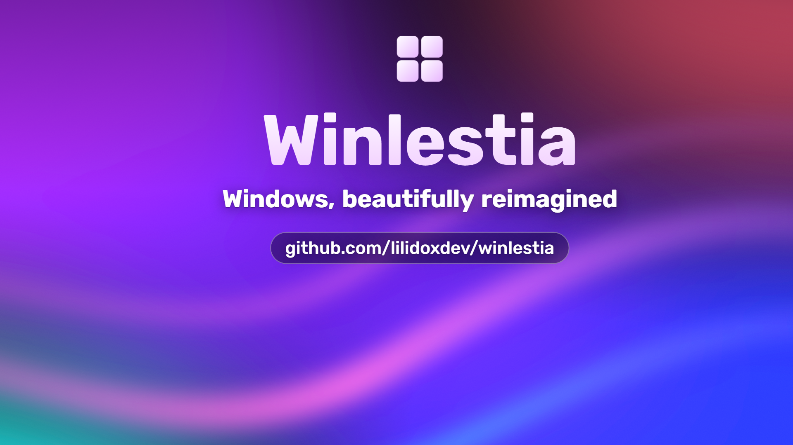
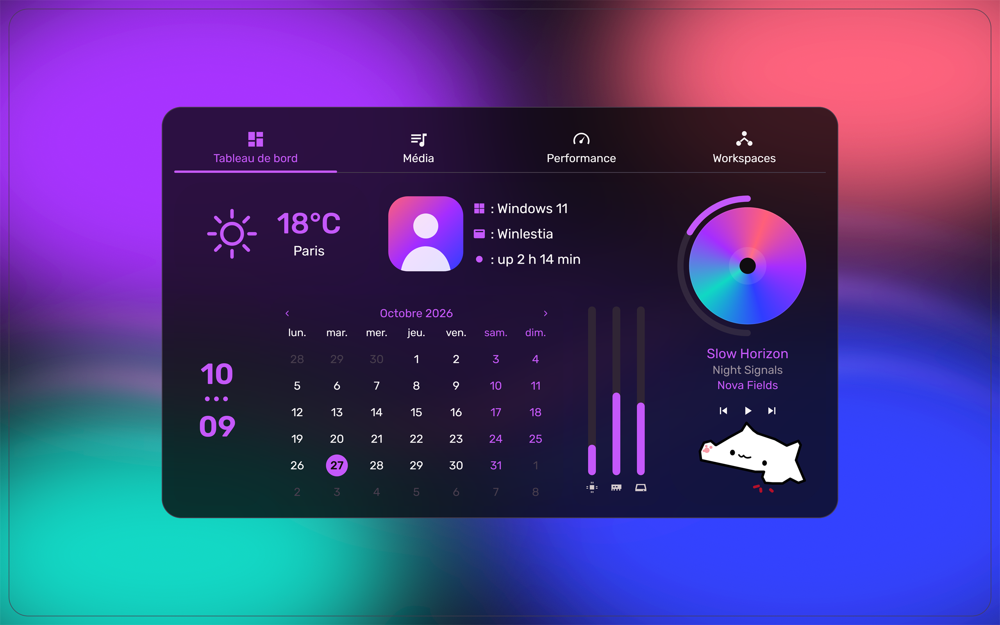
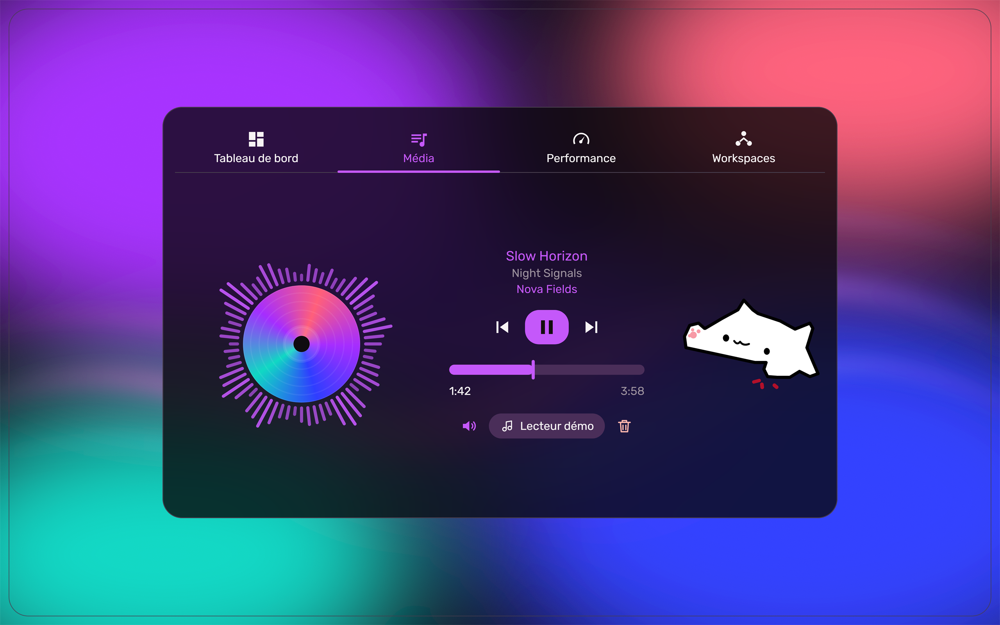
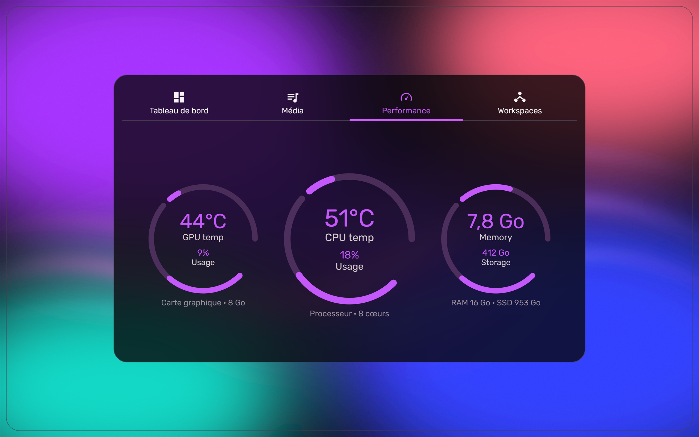
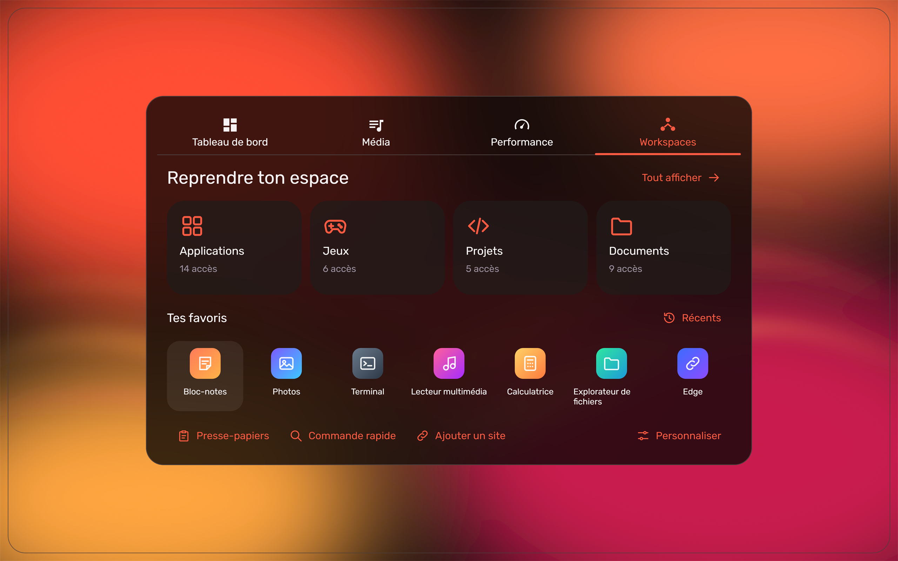
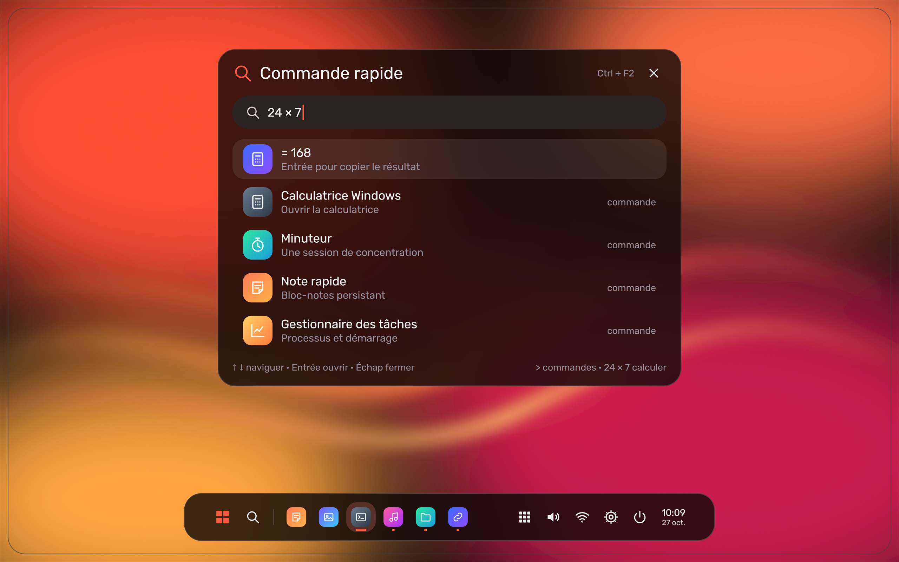
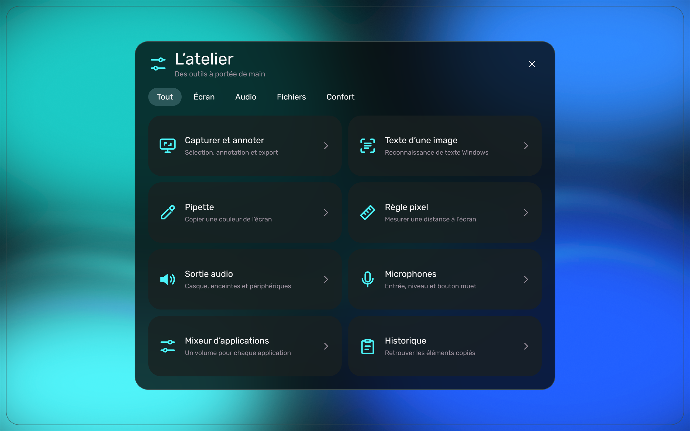
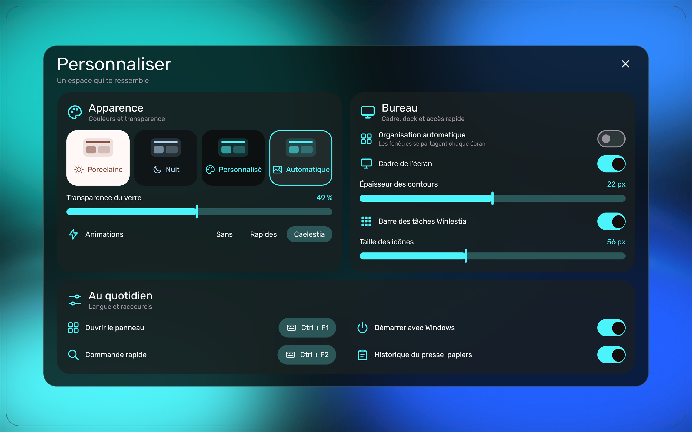
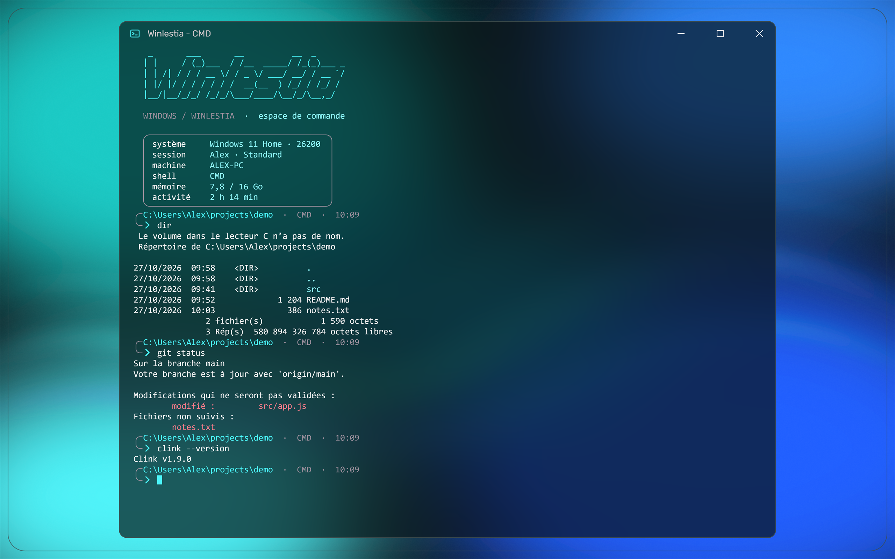

## What is Winlestia

Winlestia is a desktop shell for Windows 11. It replaces the surface of Windows, not the system: the taskbar is swapped for a dock, and a dashboard and glass panels sit on top of your normal desktop. Files, windows and wallpaper stay where they are.

The interface is a port of Caelestia; a .NET service handles the system side and Windows' own glass effect. The colors of the panels are derived from your wallpaper.

## Features

- Dashboard with media, performance and workspaces pages.
- Media page showing the track currently playing in Windows.
- Performance page with CPU, GPU, memory and network readings.
- Workspaces page listing installed applications, with search.
- Dock that replaces the Windows taskbar, with a quick command palette.
- Toolbox: screen capture, text recognition (OCR) on a captured area, color picker, clipboard history, focus timer and notes.
- Settings for theme, glass opacity, screen frame thickness, taskbar replacement, autostart and global shortcuts.
- Color palette generated from the wallpaper, with an automatic theme option.
- Real blur and rounded corners provided by Windows itself.
- Enhanced Command Prompt powered by Clink (installed automatically), with colors synchronized to the same palette.
- Two shells in one install: the Caelestia (Qt Quick) shell and a legacy Glass (WPF) shell.

## Screenshots

| | |
|---|---|
|  Dashboard |  Media player |
|  Performance monitor |  Workspaces |
|  Dock and quick command |  Toolbox |
|  Settings |  Terminal with synchronized palette |

## Demo

A vertical version for mobile viewing is available at [docs/media/winlestia-tiktok.mp4](docs/media/winlestia-tiktok.mp4).

## Installation

Requirements:

- From the release setup: Windows 11 on a 64-bit (x64) PC, nothing else to install. The setup embeds the .NET 8 runtime (self-contained) and an embedded Python 3.12 with the Qt libraries. An Internet connection is needed during setup for Clink.
- From source: Windows 11 x64, the .NET 8 SDK (or the .NET 8 Desktop Runtime to run a build), Python 3.12 only for the Qt frontend, and Internet for Clink.
- The terminal component downloads Clink 1.9.35 from its official GitHub page (github.com/chrisant996/clink), checks the archive against a known SHA256 fingerprint before extracting it, then checks each extracted Clink binary against its own fingerprint.

1. Download `Winlestia-Setup-0.7.6.exe` from the [latest release](../../releases/latest). To check the download is intact, compare the output of `Get-FileHash .\Winlestia-Setup-0.7.6.exe` in PowerShell with the line for that file in `SHA256SUMS-0.7.6.txt`, published next to it.
2. Double-click the setup. It installs into `%LOCALAPPDATA%\Programs\Winlestia` (your own user folder), so it does not ask for administrator rights.
3. Answer the prompts: the display name, whether Winlestia starts with Windows, and whether to add a desktop shortcut.
4. Winlestia starts when the setup finishes, and the dock replaces the Windows taskbar.

If the terminal theme cannot be applied (for example, no Internet during setup), the setup shows a message and the rest of Winlestia still works. The details are in `Winlestia-Terminal\install-result.json` inside the install folder. Run the setup again once you are online.

The setup is not code-signed, so Windows SmartScreen may warn on first launch: choose "More info", then "Run anyway".

To update or uninstall, run the setup again: it detects the installed version and offers both options. Uninstalling restores the Windows taskbar. You can also uninstall from Settings, Apps. Your settings are kept.

## Usage

**Launch.** Start Winlestia from the Start menu or desktop shortcut, or run `Glass-v5\Panneaux.Glass.exe` (the main program) from the install folder (`%LOCALAPPDATA%\Programs\Winlestia`). Running it again while it is already open shows the shell instead of starting a second copy. `Panneaux.Glass.exe --quit` closes it.

**Which shell starts.** By default the Caelestia interface starts; to use the older Glass interface, delete `caelestia.enabled` in the `Glass-v5` folder. `--qt-shell` / `--legacy-shell` force one or the other.

**Global shortcuts** (defaults, reassignable in Settings):

| Shortcut | Action |
|---|---|
| Ctrl+F1 | Open the panel |
| Ctrl+F2 | Quick command |
| Ctrl+F3 | Screen capture |
| Ctrl+F8 | Pin a window on top |
| Ctrl+Alt+Backspace | Emergency desktop restore (see Troubleshooting) |

## Configuration

The data folders are named `Panneaux`, the project's former name.

| File | Purpose |
|---|---|
| `Glass-v5\preferences-glass.json` (in the install folder) | Shell preferences. Change these options in Settings instead; the file is for advanced users. |
| `%LOCALAPPDATA%\Panneaux\Caelestia\weather.json` | Weather city, as `{"city": "..."}`. |
| `Glass-v5\glass.log` | Backend log. |

Advanced: the keys of `preferences-glass.json` include `ReplaceTaskbar`, `AutoTheme`, `ScreenFrame`, `FrameThickness`, `GlassOpacity`, `AutoTile`, `DesktopLogo`, `TaskbarPins` and the shortcuts `Shortcut`, `PaletteShortcut`, `CaptureShortcut`, `PinShortcut` (each with `Modifiers` and `Key`).

Command-line flags of `Panneaux.Glass.exe`:

| Flag | Effect |
|---|---|
| `--qt-shell` | Start the Caelestia (Qt Quick) shell. |
| `--legacy-shell` | Start the legacy Glass (WPF) shell, overriding `caelestia.enabled`. |
| `--restore-taskbar` | Restore the Windows taskbar and exit. |
| `--taskbar-guard <pid> <file>` | Internal use, do not run manually. |
| `--quit` | Close the running instance. |

## Troubleshooting

- **The Windows taskbar is missing.** Run `RETABLIR_BARRE_WINDOWS.exe` from the `Glass-v5` folder of the install, or run `Panneaux.Glass.exe --restore-taskbar`. A watchdog also restores the taskbar if Winlestia stops unexpectedly. You can disable the replacement with the taskbar option in Settings ("Barre des tâches Panneaux").
- **The desktop looks broken or icons are hidden.** Press Ctrl+Alt+Backspace. It runs `SECOURS_BUREAU.exe`, which brings back the Windows desktop icons, stops Winlestia and disables its autostart. The executable can also be launched directly from the install folder.
- **The Caelestia shell does not start.** Start with `Panneaux.Glass.exe --legacy-shell` to use the Glass shell, and check `Glass-v5\glass.log`.
- **A shortcut does not work.** Another application may already own the combination. Pick a different one in Settings.
- **Windows protected your PC when launching the setup.** See the SmartScreen note under Installation.

## License

Winlestia is released under the GNU General Public License v3.0. See [LICENSE](LICENSE). Third-party components and their licenses are listed in [THIRD_PARTY_NOTICES.md](THIRD_PARTY_NOTICES.md).
