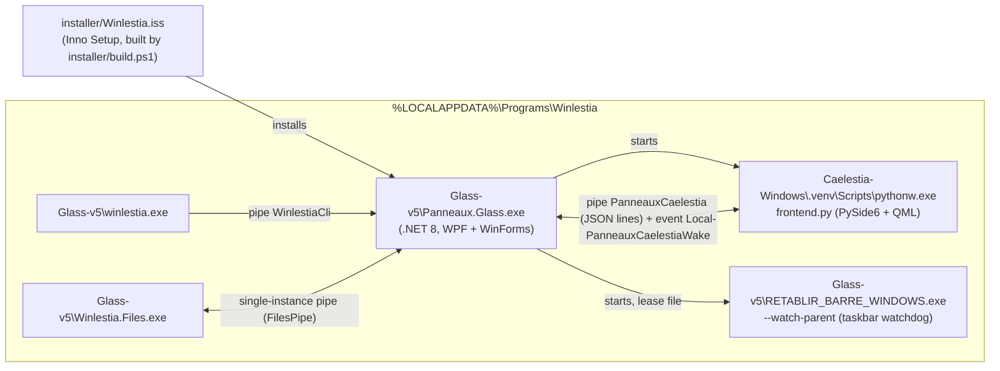

# Architecture

Winlestia is a Windows 11 desktop shell (dock, dashboard, glass panels) and a Windows port of
[Caelestia](https://github.com/caelestia-dots/shell) (Quickshell/Linux). Attribution and licences:
`THIRD_PARTY_NOTICES.md`, `src/backend/CAELESTIA-NOTICES.md`, `src/backend/LICENSE-CAELESTIA.txt`,
`src/frontend/LICENSE`, `src/frontend/THIRD_PARTY_NOTICES.md`, `src/frontend/licenses/`.

## Process map

Start-up: the backend runs in Qt mode when `--qt-shell` is passed or `caelestia.enabled` sits next to the exe
(`Coordinator.cs`, `QtMode`), unless `--legacy-shell`. It launches
`<Glass-v5>\..\Caelestia-Windows\.venv\Scripts\pythonw.exe` on `frontend.py` (override with `--qt-root=<folder>`).
A second launch signals the first instance through the `Local\PanneauxGlassV5` mutex and show/quit events, then exits.

## Folders

| Path | Responsibility |
|---|---|
| `src/backend` | `Panneaux.Glass.csproj` (net8.0-windows10.0.19041.0, WPF + WinForms). Windows integrations (taskbar hide/restore, audio, media, bookmarks, file search, hotkeys, autostart), the IPC servers, and the legacy "Glass" WPF shell (kept for compatibility, no new features). Native helpers `*.cpp` are built by `build-*.cmd` into `native/` (binaries are git-ignored). |
| `src/backend/Inventory.ps1`, `Install.ps1` | App inventory (writes `catalog.json`) and installation helper. |
| `src/frontend` | Qt Quick shell: `frontend.py` (Bridge, IPC client), `localization.py`, `interaction.py`, `search.py`, palette modules (`wallpaper_theme.py`, `chromatic_palette.py`, `custom_palette.py`), `qml/` (`qml/qs/config/Appearance.qml`, `qml/qs/services/Colours.qml`, panes, dock). Upstream tracking: `UPSTREAM.json`, `PORT_PATCHES.json`, `PORTAGE.md`. |
| `src/files` | Winlestia Files file manager (WPF, `Winlestia.Files.csproj`). |
| `src/cli` | `winlestia.exe` (`winlestia.csproj`, trimmed single file); talks to pipe `WinlestiaCli`. |
| `src/terminal` | Terminal theming (Clink, PowerShell profile, `sync_theme.py`). |
| `installer` | `build.ps1` (full chain) and `Winlestia.iss`. |
| `tests` | Console test projects (one per area) and Python scripts. |
| `docs` | User and developer documentation. |

## Contracts that must not be renamed

Renaming any of these breaks existing installs or the other side of an IPC boundary.

- **Preferences JSON.** `preferences-glass.json` is `Store.State`, serialized from `Preferences` in
  `src/backend/Models.cs` (`Store.Json`: case-insensitive read, indented). Property names are the file keys
  (for example `ReplaceTaskbar`, `ShortcutPreferences.Modifiers/Key/View`). Add properties with defaults; never rename.
- **Pipes, events, mutexes.** `PanneauxCaelestia` (`QtShellBridge.cs` server, `frontend.py` client; one JSON object per
  line, 128 KiB cap, current user only); `Local\PanneauxCaelestiaWake`; `WinlestiaCli` (`CliServer.cs`; allow-list in
  `CliCommands.cs`; reply keys `code` and `text`); the Files pipe (`FilesPipe.cs`, `src/files/SingleInstance.cs`;
  `WINLESTIA_FILES_PIPE` is test-only); `Local\PanneauxGlassV5`, `Local\PanneauxGlassTaskbarRestore`,
  `Local\PanneauxGuardReady-*` / `Local\PanneauxGuardRelease-*`.
- **JSON keys in IPC messages** are shared by `QtShellBridge.cs` / `QtDockActions.cs` and `frontend.py`; change both
  sides in one commit. `src/frontend/tests/check_bridge.py` exercises the pipe.
- **Bridge API used by QML.** The `Bridge(QObject)` class in `frontend.py` exposes `Property` / `Slot` names that
  `qml/**/*.qml` reference as `Bridge.<name>` (hundreds of uses). Grep the QML before touching one.
- **Localization.** `ROWS` in `src/frontend/localization.py` are `fr|en|es` lines keyed by the French text. The French
  string passed to `qsTr(...)` / `QCoreApplication.translate` must match the first column exactly.
- **Command-line switches** (`Coordinator.cs`, `Main`): `--qt-shell`, `--legacy-shell`, `--qt-root=`, `--show`,
  `--quit`, `--restore` (launches `SECOURS_BUREAU.exe`), `--restore-taskbar`, `--taskbar-guard <parentPid> <leaseFile>`
  (managed watchdog), `--taskbar-state`, plus `--verify-*`, `--benchmark*` and `--preview*` developer switches.
  `RETABLIR_BARRE_WINDOWS.exe` takes `--watch-parent` (`ShellTaskbar.cs`).
- **CLI commands** of `winlestia.exe`: `CliCommands.HelpText` and `tests/CliCommands`.
- **Catalogue.** `catalog.json` is written by `Inventory.ps1` (`Id`, `Name`, `Target`, `Section`, `Category`,
  `IconPath`, `SearchText`, ...) and read by `Store.LoadCatalogue` (`Models.cs`) and `AppCatalogueWatcher.cs`.
  Keep PowerShell and C# field names identical.
- **Partial classes** spread over several files: `QtShellBridge` (`QtShellBridge.cs`, `QtDockActions.cs`), `HomeWindow`
  (+`HomeShellPages.cs`), `ExplorerAppearance` (+`.StableIcons.cs`), `MonitorBrightness` (+`MonitorDisplays.cs`),
  `UI` (`UiTokens.cs`, `Visuals.cs`), `WindowTiler` (+`WindowTilerKeys.cs`), `MainWindow.*.cs` in `src/files`. Tests
  link source files by name; update `tests/*/*.csproj` if you move or rename a file.
- **Legacy names.** Namespace `PanneauxGlass`, assembly `Panneaux.Glass`, folder `%LOCALAPPDATA%\Panneaux`,
  `Glass-v5`, `Caelestia-Windows`, scheduled task `WinlestiaShell`. These are compatibility constraints.

## Data locations

| What | Where |
|---|---|
| User data (preferences, `glass.log`, clipboard, pins) | `%LOCALAPPDATA%\Panneaux` (`Store.DataDir`, `Models.cs`); `WINLESTIA_DATA_DIR` overrides it (tests). Legacy install-folder data is migrated by `Store.MigrateLegacyData`. |
| Installed program | `%LOCALAPPDATA%\Programs\Winlestia` (`Glass-v5`, `Caelestia-Windows`, `Winlestia-Terminal`) |
| Taskbar lease (restore data) | `TaskbarNative.LeasePath` (`taskbar-session.json`) |
| Autostart | Scheduled task `WinlestiaShell` (see `docs/WINDOWS-INTEGRATIONS.md`) |

## Restore paths (invariant)

Every way back to the Windows taskbar must keep working. User instructions: `docs/RESTORE.md`.

| Path | Code |
|---|---|
| Watchdog, started when the taskbar is hidden | `ShellTaskbar.Enable` starts `RETABLIR_BARRE_WINDOWS.exe --watch-parent` (source `src/backend/TaskbarRescue.cpp`); fallback `Panneaux.Glass.exe --taskbar-guard` -> `TaskbarNative.Guard` |
| `--restore-taskbar` | `Coordinator.cs` -> `TaskbarNative.RestoreSaved` |
| `RETABLIR_BARRE_WINDOWS.exe` | `src/backend/native/`, copied to `Glass-v5` by `installer/build.ps1` |
| `SECOURS_BUREAU.exe` | `src/backend/Secours.cpp`, `build-rescue.cmd` |
| Ctrl+Alt+Backspace | `GlobalShortcut.cs` (`RegisterHotKey`, modifiers 0x4003, key 0x08) |
